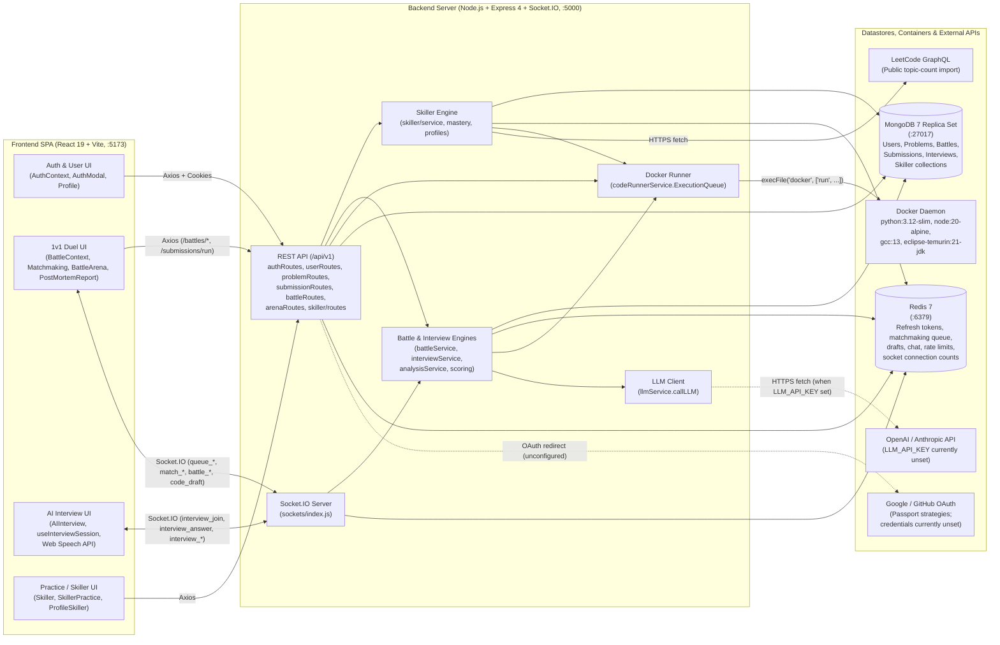

# CodingArena — System-Wide Architecture Overview

## 1. What CodingArena Is

CodingArena is a full-stack competitive coding and technical-interview training web application built with a React 19 + Vite single-page frontend and a Node.js + Express 4 + Socket.IO backend backed by MongoDB, Redis, and Docker containers. It is organized around four functional modules: **Auth and User** (local credential and OAuth authentication, JWT session refresh, and player profiles), **1v1 Duel** (real-time Elo matchmaking, synchronized coding rooms, sandboxed multi-language Docker execution, live chat, forfeit/disconnect handling, and multi-factor scoring), **AI Interview** (per-player oral-defense Q&A immediately following the coding phase, using browser speech synthesis/recognition and LLM or deterministic code-grounded questions and grading), and **Practice (Skiller)** (an independent adaptive practice module with a 24-problem curriculum across 6 DSA topics, mastery scoring, and optional LeetCode topic-count imports). Currently, local auth, ranked 1v1 matchmaking, Docker code execution, Skiller practice, and fallback/heuristic AI interviews run end to end against local MongoDB (replica set) and Redis, while Google/GitHub OAuth credentials and `LLM_API_KEY` are unset in `backend/.env` and friends/private rooms/extra battle modes remain UI/schema placeholders.

---

## 2. System Architecture Diagram

The diagram below maps every major runtime component and shows which of the four modules interacts with which backend service or datastore.

**Module-to-infrastructure summary:**
- **Auth and User**: Frontend (`AuthContext.jsx`, `AuthModal.jsx`, `AuthCallback.jsx`, `Profile.jsx`) -> REST (`/api/v1/auth/*`, `/api/v1/users/*`) -> MongoDB (`User`) + Redis (`refresh:<userId>`) + Passport (`GoogleStrategy`, `GitHubStrategy`, unconfigured). Socket.IO middleware (`sockets/index.js`) also verifies the JWT access token and tracks `user:connections:<userId>` in Redis.
- **1v1 Duel**: Frontend (`BattleContext.jsx`, `Matchmaking.jsx`, `BattleArena.jsx`, `PostMortemReport.jsx`) -> Socket.IO + REST (`/api/v1/battles/*`, `/api/v1/submissions/run`, `/api/v1/arena/stats`) -> `battleService.js` -> MongoDB (`Battle`, `Problem`, `Submission`, `User`) + Redis (`matchmaking:*`, `cooldown:*`, `draft:*`, `battle:chat:*`, `ratelimit:*`) + Docker runner (`codeRunnerService.js`) + `analysisService.js` (LLM).
- **AI Interview**: Frontend (`AIInterview.jsx`, `InterviewSetup.jsx`, `useInterviewSession.js`, `BattleContext.jsx`) -> Socket.IO (`interview_join`, `interview_answer`, `interview_*`, `opponent_phase`) -> `interviewService.js` -> MongoDB (`Interview`, `Battle`) + Redis (`ratelimit:interview:<userId>`) + `llmService.js` / `interviewQuestions.js` / `interviewGrading.js`.
- **Practice (Skiller)**: Frontend (`Skiller.jsx`, `SkillerPractice.jsx`, `ProfileSkiller.jsx`, `useSkillerDraft.js`) -> REST (`/api/v1/skiller/*`) -> `skiller/service.js` -> MongoDB (`skiller_profiles`, `skiller_problems`, `skiller_attempts`) + Redis (`skiller:limit:*`) + Docker runner (`codeRunnerService.js`) + LeetCode public GraphQL (`skiller/profiles.js`).

---

## 3. Technology Stack Table

| Technology | Version (`package.json`) | What it does here | Which module uses it | Why chosen over the obvious alternative |
| --- | --- | --- | --- | --- |
| **React 19** | `^19.2.7` | Component UI rendering, hooks, and context providers (`AuthProvider`, `BattleProvider`). | All 4 modules | Reasonable justification, not documented (ecosystem maturity, component/hook model over Vue/Angular). |
| **Vite** | `^7.1.12` | Frontend dev server (`:5173`), ES module bundling, and `@tailwindcss/vite` integration (`frontend/vite.config.js`). | All 4 modules (build/dev) | Reasonable justification, not documented (fast HMR and simpler config over Webpack/CRA). |
| **React Router** | `react-router-dom ^7.18.5` | Client-side routing (`/`, `/dashboard`, `/battle-modes`, `/skiller`, `/skiller/practice/:attemptId`, `/ai-interview`, `/match-report/:id`, `/u/:username`, `/auth/callback`) and `ProtectedRoute` guards (`frontend/src/App.jsx`). | All 4 modules | Reasonable justification, not documented (de-facto React SPA router over TanStack Router). |
| **Axios** | `^1.21.0` | HTTP client with `withCredentials: true`, request interceptor injecting `Authorization: Bearer`, and response 401 interceptor deduplicating concurrent `/auth/refresh` calls via `refreshPromise` (`frontend/src/services/api.js`). | All 4 modules | Reasonable justification, not documented (interceptor pipeline for transparent 401 token refresh over raw `fetch`). |
| **Tailwind CSS** | `^4.2.4` (`@tailwindcss/vite`) | Utility-first styling and `@theme` CSS custom properties (`frontend/src/index.css`), alongside module-specific CSS files. | All 4 modules (shared layout, navbar, landing, modals) | Reasonable justification, not documented (rapid utility styling alongside custom CSS themes over CSS-in-JS/Bootstrap). |
| **GSAP** | `^3.15.0` | Dynamically imported scroll reveal animations, parallax scrubbing, and 3D card tilt via `ScrollTrigger` (`frontend/src/components/ScrollEffects.jsx`), disabled under `prefers-reduced-motion`. | Shared UI shell (landing/pages outside reference view) | Reasonable justification, not documented (timeline/scroll-trigger control over Framer Motion/CSS transitions). |
| **Express 4** | `^4.21.2` | HTTP server routing under `/api/v1`, JSON/URL-encoded body parsing, CORS, `cookie-parser`, and centralized error handling (`backend/src/app.js`). | All 4 modules | Reasonable justification, not documented (lightweight Node middleware ecosystem over Fastify/NestJS). |
| **Socket.IO** | `^4.8.1` (server), `^4.8.4` (client) | Authenticated WebSocket/long-polling transport with per-user rooms (`user:<userId>`), acknowledgment callbacks, and `timeout()` emitters (`backend/src/sockets/index.js`, `frontend/src/services/socket.js`). | 1v1 Duel, AI Interview, Auth (handshake JWT + online presence) | Reasonable justification, not documented (built-in rooms, reconnects, and ack callbacks over raw `ws`). |
| **Mongoose** | `^8.14.0` | ODM schemas, unique/partial indexes, `select: false` projections for sensitive fields (`passwordHash`, `hiddenTestCases`, `finalCode`, `myTests`), and replica-set transactions (`backend/src/models/*`, `backend/src/skiller/models.js`). | All 4 modules | Reasonable justification, not documented (schema validation, `select: false`, and query ergonomics over raw MongoDB driver). |
| **ioredis** | `^5.6.1` | Redis client for refresh tokens, matchmaking sorted set + hash + Lua atomic pop (`MATCH_LUA`), private code drafts, chat history, rate limiters, and socket connection counters (`backend/src/config/redis.js`). | All 4 modules | Reasonable justification, not documented (native Promise/Lua `eval` support and reconnection handling over `node-redis`). |
| **Passport** | `^0.7.0` (`passport-google-oauth20`, `passport-github2`) | Stateless (`session: false`) OAuth 2.0 strategy definitions and profile/verified-email extraction (`backend/src/config/passport.js`, `authController.js`). | Auth and User | Reasonable justification, not documented (standard multi-provider OAuth strategy abstraction over hand-rolled OAuth flows). |
| **JWT** | `jsonwebtoken ^9.0.3` | Signs and verifies short-lived HS256 access tokens (`15m`) and refresh tokens (`7d`) (`authController.js`, `middleware/auth.js`, `sockets/index.js`). | Auth and User (used by all authenticated REST/Socket calls) | Reasonable justification, not documented (stateless access-token verification on every REST/Socket request over server-side sessions). |
| **bcryptjs** | `^3.0.3` | Hashes passwords with cost factor `10` (`bcrypt.hash`) on registration and verifies them (`bcrypt.compare`) on login (`authController.js`). | Auth and User | Reasonable justification, not documented (pure-JS bcrypt avoiding native C++ build issues of `bcrypt` node-gyp). |
| **Zod** | `^3.24.4` | Runtime request-body/param schema validation: `registerSchema` in `authController.js`, and all Skiller request payloads/params in `backend/src/skiller/routes.js`. | Auth and User (`register`), Practice (Skiller) | Reasonable justification, not documented (declarative TypeScript-style schema validation over Joi/express-validator). |
| **Docker** | CLI `docker run` via `child_process.execFile` | Ephemeral, sandboxed per-submission code execution containers (`python:3.12-slim`, `node:20-alpine`, `gcc:13`, `eclipse-temurin:21-jdk`) with `--network none`, `--read-only`, CPU/memory/PID caps (`codeRunnerService.js`). | 1v1 Duel, Practice (Skiller), standalone `/submissions` | Reasonable justification, not documented (OS/filesystem/network isolation over unsafe `vm`/child-process host execution or external judge SaaS). |

---

## 4. End-to-End Request Lifecycle of One Full Match

Below is the complete chronological lifecycle of a single 1v1 ranked duel from queue entry to final report, naming the exact REST routes, Socket.IO events (`backend/src/sockets/index.js`), and internal engine steps (`battleService.js`, `interviewService.js`):

1. **Authenticate & Connect Socket**: Players A and B sign in via `POST /api/v1/auth/login` (or `/auth/register` or `/auth/refresh`), receive a JWT `accessToken` + `HttpOnly` `refreshToken` cookie (`authController.js`), and open an authenticated Socket.IO connection (`connectSocket` in `frontend/src/services/socket.js`). On handshake, `sockets/index.js` verifies the JWT, joins room `user:<userId>`, increments Redis `user:connections:<userId>`, and marks `User.isOnline = true`.
2. **Enter Matchmaking Queue**: Player A and Player B emit `queue_join` (`{ mode: "ranked_1v1" }`) with an ack callback. `enqueuePlayer` (`battleService.js`) checks Redis `cooldown:<userId>`, verifies neither is already queued or in an active battle, checks `Problem.exists({})`, and writes `ZADD matchmaking:queue:ranked_1v1 <rating> <userId>` and `HSET matchmaking:times <userId> <timestamp>`. Every 3 seconds, `broadcastQueueStatus` emits `queue_status` (`{ waitingSeconds, playersInQueue }`) to each queued user.
3. **Match Found & Accept Window**: Every 1 second, `runMatcherTick` (`battleService.js`) computes expanding Elo tolerance `min(600, 100 + 25 * waitedSeconds)`. When `|ratingA - ratingB| <= max(gapA, gapB)`, `MATCH_LUA` atomically pops both players from Redis. `createMatchedBattle` picks an unsolved `Problem`, creates a `Battle` with `status: 'pending'` and `acceptDeadline` (`ACCEPT_WINDOW_SECONDS = 30`), arms `acceptTimers[battleId]`, and emits `match_found` (`{ battleId, acceptDeadline, serverNow, opponent, problem, ratingPreview }`) to both `user:<id>` rooms.
4. **Match Accept -> Battle Start**: Both players emit `match_accept` (`{ battleId }`). When both `players[].response === 'accepted'`, `acceptMatch` clears `acceptTimers[battleId]` and calls `startBattle` (`battleService.js`), which transitions `Battle.status` to `'active'`, sets `startedAt`, `endsAt` (`BATTLE_DURATION_SECONDS = 900`), and `battleDurationMs`, arms `battleTimers[battleId]`, and emits `battle_start` (`{ battleId, forfeitRatingLoss, serverNow, startedAt, endsAt, problem, opponent }`) to both players. (On page refresh or reconnect, the client calls `GET /api/v1/battles/active` and emits `battle_join`, receiving `battle_state` via ack and emit.)
5. **Live Coding, Drafts, Chat, and Samples**:
   - **Sample runs**: Clicking *Run samples* calls `POST /api/v1/submissions/run` (`submissionController.runCode`), rate-limited by `middleware/rateLimit.js` (10 req/60s), running `sampleTestCases` inside an isolated Docker container (`codeRunnerService.runSubmission`).
   - **Draft sync**: `BattleArena.jsx` / `BattleContext.jsx` emits `code_draft` (`{ battleId, language, code }`) throttled client-side to >=5s (queue-paced >=2.1s) and server-side (`saveDraft`) to 1 per 2s, stored in Redis `draft:<battleId>:<userId>` (1h TTL, max 20,000 chars).
   - **Live chat**: Players emit `battle_chat` (`{ battleId, text }`). `handleChatMessage` enforces 5 msgs/5s via Redis `ratelimit:chat:<userId>:<battleId>`, strips HTML tags, appends to Redis list `battle:chat:<battleId>`, and emits `battle_chat_message` (`{ from, text, at }`) to both players.
   - **Disconnect grace**: If a player's socket count drops to 0 during coding, `handleDisconnect` emits `opponent_disconnected` (`{ graceSeconds }`) and starts `disconnectTimers` (`RECONNECT_GRACE_SECONDS = 30`). Reconnecting cancels it and emits `opponent_reconnected`.
6. **Code Submission & Independent Coding Lock**: Submitting code calls `POST /api/v1/battles/:id/submit` (`battleController.submitBattleCode` -> `battleService.finishPlayer`), which enforces 10/min in Redis, checks `isNoSubmission` (`starterCode.js`), runs all sample + hidden tests in Docker (`evaluateCode`), saves a `Submission`, updates `bestPassed` and `timeline`, and emits `submission_result` to the submitter.
   - If partial tests pass, the opponent receives `opponent_progress` (`{ passedCount, totalCount, at }`) and coding continues.
   - Coding ends for a player on: (a) full-pass submission (`finishedBy: 'solved'`), (b) clicking *Finish coding early* which emits `battle_finish` (`finishedBy: 'locked'`), or (c) `endsAt` timeout (`onBattleTimeUp` -> `finishedBy: 'timeout'`).
   - `endCoding` (`battleService.js`) atomically flips that player's `phase` to `'interview'`, freezes `finalCode` (from submission or latest Redis draft), shortens `endsAt` via `$min` to `now + AFTER_FIRST_FINISH_SECONDS` (default 180s), emits `opponent_phase` (`{ phase: 'interview', total }`) to the opponent and `interview_thinking` (`{}`) to the finisher, and starts background `processPlayer`.
7. **Background Evaluation, Code Analysis, and Per-Player AI Interview**:
   - `processPlayer` evaluates frozen draft code if not already evaluated, emits `you_finished` (`{ endsAt, serverNow, passedCount, totalCount }`) and `opponent_finished` (`{ ..., solveTimeMs }`), runs `analyzeSolution` (`analysisService.js`, bounded by `LLM_TIMEOUT_MS + 5000`), checkpoints `codingProcessedAt`, and calls `interviewService.start`.
   - If the player submitted empty/starter-only code (`isNoSubmission`), the interview is marked `skipped` (score 0) and `interview_complete` is emitted immediately.
   - Otherwise, `interviewService.nextQuestion` generates one question at a time (LLM if `LLM_API_KEY` or `LLM_MOCK=true`, else deterministic `codeQuestion` fallback from `interviewQuestions.js`) and emits `interview_started` (for question 0) or `interview_question` (for questions 1..N-1), plus `opponent_phase` to the opponent.
   - The frontend (`AIInterview.jsx`, `useInterviewSession.js`) reads the question aloud (Web Speech `speechSynthesis`), runs a 5s preparation countdown, captures voice/typed input, and emits `interview_answer` (`{ battleId, questionIndex, text, inputMode, skip }`), which `interviewService.answer` validates and rate-limits (1 per 2s) before advancing or finishing. On refresh, `interview_join` restores the open question, deadlines, `finalCode`, and answered `history`.
   - When all `INTERVIEW_QUESTIONS` (default 4) are answered/skipped/expired or `INTERVIEW_MAX_SECONDS` (480s) hits, `interviewService.finish` grades the transcript (via LLM or `heuristicGrade` fallback in `interviewGrading.js`), emits `interview_complete` and `opponent_phase` (`{ phase: 'done' }`), and calls `playerDone` (`battleService.js`).
8. **Finalization, Scoring, Elo/XP Transaction, and Report**:
   - Once **both** players have `phase === 'done'` and `codingProcessedAt` set (or immediately on `battle_forfeit` / coding disconnect timeout / hard cap `closeAtHardCap`), `finishBattle` atomically transitions `Battle.status` from `'active'` to `'finalizing'` and emits `battle_finalizing` (`{}`) to both players.
   - `computeResult` (`backend/src/config/scoring.js`) computes per-component scores (`WEIGHTS`: correctness 25, speed 8, runtime 7, timeComplexity 12, spaceComplexity 3, quality 15, interview 30), renormalizes non-null weights (`scoringInfo`), applies the tie-break chain / `EPS = 0.01`, and determines the winner (respecting forfeit/disconnect precedence).
   - Inside a MongoDB replica-set transaction (with standalone `appliedBattleResults` idempotency fallback), `finishBattle` updates both `User` documents (`rating`, `xp`, `stats`, `appliedBattleResults`), saves immutable `record` snapshots, sets `Battle.status = 'finished'`, and emits a separate participant-specific `battle_end` payload to each `user:<id>` room (also fetchable via `GET /api/v1/battles/:id`). `PostMortemReport.jsx` renders the score matrix, radar chart, timeline, private interview transcript, and private test/code review.
