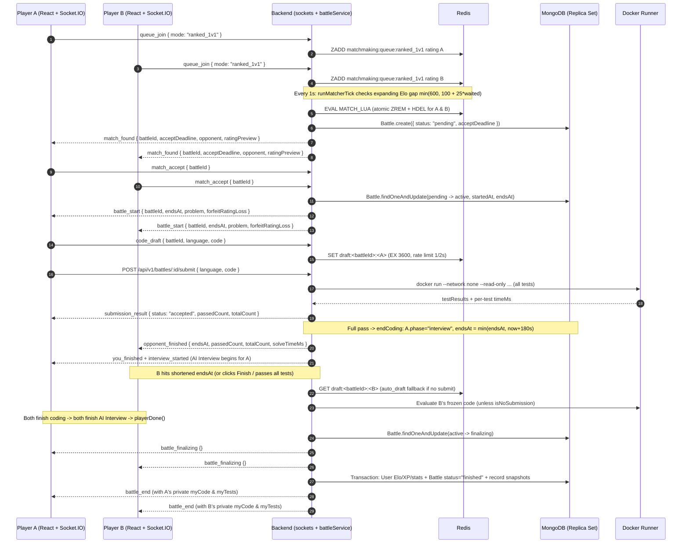

# Module 1: 1v1 Duel

> **Presenter**: Team Member 1 — Real-Time Matchmaking, Coding Arena, Docker Runner & Scoring

---

## 1. Purpose and Scope

The **1v1 Duel** module owns the complete competitive head-to-head coding match lifecycle:
- **Matchmaking**: Elo-based player queueing in Redis (`enqueuePlayer`, `dequeuePlayer`, `runMatcherTick`, `broadcastQueueStatus`), 30-second match accept/decline window (`acceptMatch`, `declineMatch`, `onAcceptTimeout`), and duplicate-free problem selection (`createMatchedBattle`).
- **Live Coding Room**: Synchronized countdown timer (`BATTLE_DURATION_SECONDS`), per-user Socket.IO room messaging (`user:<userId>`), private draft syncing (`saveDraft` via `code_draft`), live tactical chat (`handleChatMessage`), sample test execution (`POST /api/v1/submissions/run`), full-suite duel submission (`POST /api/v1/battles/:id/submit`), per-player coding lock (`endCoding`, `finishPlayer`), forfeit (`forfeitBattle`), and disconnect grace (`handleDisconnect`, `handleReconnect`).
- **Sandboxed Code Execution**: Ephemeral per-run Docker containers (`codeRunnerService.js`: `ExecutionQueue`, `runContainerTask`, `runSubmission`) and starter/empty-code detection (`starterCode.js`: `isNoSubmission`, `sanitizeStarterCode`).
- **Finalization & Scoring**: Waiting until both players finish coding and their AI interviews, computing multi-factor scores (`scoring.js`: `computeResult`, `scoringInfo`), updating Elo rating/XP/stats atomically (`finishBattle`), and serving participant-safe reports (`PostMortemReport.jsx`, `GET /api/v1/battles/:id`).

**What it does NOT own**:
- User registration, login, JWT/cookie issuance, and OAuth callbacks (owned by **Auth and User**, though `Battle` updates `User.rating`, `User.xp`, and `User.stats` at match end).
- Sequential oral-defense question generation and grading (owned by **AI Interview** in `interviewService.js`, invoked by `battleService.js` when a player finishes coding).
- Adaptive solo practice, diagnostics, and Skiller mastery tracking (owned by **Practice / Skiller**, which only reuses `runSubmission` and `starterCode.js`).
- **Placeholder modes**: Friends (`User.friends` has no endpoints) and Private Rooms / Squads / Debug Blitz / SQL Clash (`CommandDeck.jsx` and `BattleModes.jsx` show them as disabled/"Coming soon").

---

## 2. Technology Map

| Technology | Role in 1v1 Duel | Exact Files |
| --- | --- | --- |
| **Socket.IO** (`4.8.x`) | Authenticated bidirectional events (`queue_*`, `match_*`, `battle_*`, `code_draft`, `submission_result`, `opponent_progress`), per-user rooms (`user:<id>`), ack callbacks. | `backend/src/sockets/index.js`, `frontend/src/services/socket.js`, `frontend/src/context/BattleContext.jsx` |
| **Express 4** | REST endpoints for battle state, history, duel submission, sample/standalone execution, and live arena stats. | `backend/src/routes/battleRoutes.js`, `submissionRoutes.js`, `problemRoutes.js`, `arenaRoutes.js`, `backend/src/controllers/*` |
| **Redis (`ioredis`)** | Sorted set (`matchmaking:queue:ranked_1v1`), join-time hash (`matchmaking:times`), atomic Lua match pop (`MATCH_LUA`), cooldowns, drafts (`draft:<battleId>:<userId>`), chat history (`battle:chat:<battleId>`), rate limits, connection counters. | `backend/src/config/redis.js`, `backend/src/services/battleService.js`, `backend/src/controllers/battleController.js`, `backend/src/middleware/rateLimit.js` |
| **MongoDB (`Mongoose`)** | Persistent `Battle`, `Problem`, `Submission`, and `User` documents; replica-set transactions for Elo/XP/record updates. | `backend/src/models/Battle.js`, `Problem.js`, `Submission.js`, `User.js`, `backend/src/services/battleService.js` |
| **Docker** | Isolated, ephemeral containers (`python:3.12-slim`, `node:20-alpine`, `gcc:13`, `eclipse-temurin:21-jdk`) executing untrusted code per submission. | `backend/src/services/codeRunnerService.js`, `backend/package.json` (`pull-images`) |
| **Node `crypto`** | SHA-256 tokenization fingerprinting of starter/legacy code (`isNoSubmission`) and unique container/temp-dir IDs. | `backend/src/services/starterCode.js`, `backend/src/services/codeRunnerService.js` |
| **React 19 + Context** | `BattleProvider` state machine, `Matchmaking.jsx`, `BattleArena.jsx`, `ArenaChat.jsx`, `SurrenderBattle.jsx`, `PostMortemReport.jsx` (with SVG radar & timeline charts). | `frontend/src/context/BattleContext.jsx`, `frontend/src/components/*` |
| **LLM Client (`fetch`)** | Post-coding complexity (`timeComplexity`, `spaceComplexity`) and code quality (`naming`, `readability`, `maintainability`, `idioms`) analysis. | `backend/src/services/analysisService.js`, `backend/src/services/llmService.js` |

---

## 3. How It Works, Step by Step

### REST Endpoints Owned or Used by 1v1 Duel

| Method & Path | Auth / Rate Limit | Request Body / Query | Response (`{ success, data }`) | Source |
| --- | --- | --- | --- | --- |
| `GET /api/v1/arena/stats` | Public | — | `{ online, inQueue, inBattles }` | `arenaController.getStats`, `battleService.getArenaStats` |
| `GET /api/v1/battles/active` | `auth` | — | `{ battle: battle_state \| null }` | `battleController.getActiveBattle` |
| `GET /api/v1/battles/me` | `auth` | `?page=1&limit=10` (max 50) | `{ battles: [battle_end_shape], total, page, limit }` | `battleController.getMyBattles` |
| `GET /api/v1/battles/:id` | `auth` + participant check | — | Participant-safe `battle_end` shape | `battleController.getBattleById` |
| `POST /api/v1/battles/:id/submit` | `auth` + Redis `10/60s` | `{ language, code }` (`<= 20000` chars) | `{ status, passedCount, totalCount, timeMs }` | `battleController.submitBattleCode` |
| `POST /api/v1/submissions/run` | `auth` + `rateLimit` (`10/60s`) | `{ problemId \| slug, language, code, customInput? }` | `{ status, error, testResults, passedCount, totalCount, executionTimeMs }` | `submissionController.runCode` |
| `GET /api/v1/problems` & `/:slug` | Public | `?difficulty&category&tag&search&page&limit` | Sanitized problem(s) without `hiddenTestCases` | `problemController.js` |

### Socket.IO Events & Payloads (`backend/src/sockets/index.js` & `battleService.js`)

Socket.IO does **not** create separate `battle:<id>` rooms; instead, every socket joins `user:<userId>` on connection, and `battleService.js` emits directly to `ioInstance.to('user:' + userId)`.

| Direction | Event | Payload Fields | Behavior |
| --- | --- | --- | --- |
| Client -> Server | `queue_join` | `{ mode? }` (default `'ranked_1v1'`) | Calls `enqueuePlayer`; ack `{ success, message }`. |
| Client -> Server | `queue_leave` | `{}` | Calls `dequeuePlayer`; ack `{ success, message }`. |
| Client -> Server | `match_accept` / `match_decline` | `{ battleId }` | Records accept (starts battle when both accept) or cancels with cooldown; ack `{ success, message }`. |
| Client -> Server | `battle_join` | `{ battleId }` | Calls `getBattleState`, emits `battle_state`, ack `{ success, data }`. |
| Client -> Server | `code_draft` | `{ battleId, language, code }` | Calls `saveDraft` (Redis `draft:<battleId>:<userId>`, 2s limit, 3600s TTL); ack `{ success, message }`. |
| Client -> Server | `battle_finish` | `{ battleId }` | Calls `finishPlayer(battleId, userId)` -> `endCoding(..., 'locked')`; locks coding early. |
| Client -> Server | `battle_forfeit` | `{ battleId }` | Calls `forfeitBattle` -> immediate `finishBattle(..., 'forfeit')`; ack `{ success, message }`. |
| Client -> Server | `battle_chat` | `{ battleId, text }` | Strips HTML, 200-char max, 5 msgs/5s, emits `battle_chat_message`. |
| Server -> Client | `queue_status` | `{ waitingSeconds, playersInQueue }` | Broadcast every 3s by `broadcastQueueStatus`. |
| Server -> Client | `queue_error` | `{ message }` | Emitted if `createMatchedBattle` fails after Lua pop. |
| Server -> Client | `match_found` | `{ battleId, acceptDeadline, serverNow, opponent, problem, ratingPreview }` | Sent to both matched players. |
| Server -> Client | `match_cancelled` | `{ battleId, reason }` | `reason`: `'declined'` or `'timeout'`. |
| Server -> Client | `battle_start` | `{ battleId, forfeitRatingLoss, serverNow, startedAt, endsAt, problem, opponent }` | Sent when both players accept. |
| Server -> Client | `battle_state` | `formatBattleState`: `{ battleId, status, forfeitRatingLoss, serverNow, myPhase, opponentPhase, ownFinished, opponentFinished, startedAt, endsAt, opponent, players, problem, ownProgress, opponentProgress, lastChatMessages }` | Sent on `battle_join` (and `GET /battles/active`). |
| Server -> Client | `submission_result` | `{ status, passedCount, totalCount, timeMs }` | Sent to submitter after `POST /battles/:id/submit`. |
| Server -> Client | `opponent_progress` | `{ passedCount, totalCount, at }` | Sent to opponent on partial submission. |
| Server -> Client | `you_finished` | `{ endsAt, serverNow, passedCount, totalCount }` | Sent to finisher once `processPlayer` stores evaluation. |
| Server -> Client | `opponent_finished` | `{ endsAt, serverNow, passedCount, totalCount, solveTimeMs }` | Sent to opponent (never includes code/test details). |
| Server -> Client | `opponent_disconnected` / `opponent_reconnected` | `{ graceSeconds }` / none | Sent only while the disconnected player is in `phase === 'coding'`. |
| Server -> Client | `battle_chat_message` | `{ from, text, at }` | Sent to both players, persisted in Redis (last 50, 24h TTL). |
| Server -> Client | `battle_finalizing` | `{}` | Sent to both players when `finishBattle` acquires `'finalizing'` lock. |
| Server -> Client | `battle_end` | `formatBattleEndShape`: `{ battleId, status, scoring, headToHead, myCode, winner, reason, problem, players, timeline }` | Participant-specific (`myCode`, `myTests`, `feedback`, `interview.perQuestion` only for `userId`). |

### Step-by-Step Sequence Diagram



---

## 4. Key Code Walkthrough

### Snippet 1: Atomic Matchmaking Pop (`backend/src/services/battleService.js`, `MATCH_LUA` & `runMatcherTick`)

```js
const MATCH_LUA = `
if redis.call('ZSCORE', KEYS[1], ARGV[1]) and redis.call('ZSCORE', KEYS[1], ARGV[2]) then
  redis.call('ZREM', KEYS[1], ARGV[1], ARGV[2])
  redis.call('HDEL', KEYS[2], ARGV[1], ARGV[2])
  return 1
else
  return 0
end
`;
// ...
const waitedA = Math.floor((now - Number(tA)) / 1000);
const gapA = Math.min(600, 100 + 25 * waitedA);
// ...
const diff = Math.abs(Number(scoreA) - Number(scoreB));
if (diff <= Math.max(gapA, gapB)) {
  const removed = await redis.eval(
    MATCH_LUA,
    2,
    QUEUE_KEY,
    'matchmaking:times',
    uA,
    uB
  );
  if (removed === 1) {
    matchedSet.add(uA);
    matchedSet.add(uB);
```
- **Why**: `enqueuePlayer` stores rating in a Redis sorted set (`QUEUE_KEY`) and join timestamp in a hash (`matchmaking:times`). Wait time widens each player's acceptable rating gap from `100` Elo by `+25/sec` up to `600`.
- **Non-obvious detail**: Checking `ZSCORE` and removing both users inside a single Redis Lua script (`MATCH_LUA`) prevents a race condition where a player leaves the queue (`queue_leave`) or gets paired twice between checking and removing. If `createMatchedBattle` later throws, the server emits `queue_error` so clients stop spinning rather than hanging silently.

### Snippet 2: Sandboxed Docker Execution (`backend/src/services/codeRunnerService.js`, `runContainerTask`)

```js
    const timeLimitSec = Math.max(1, Math.ceil(timeLimitMs / 1000));
    const totalTimeoutMs = Math.max(10000, timeLimitMs * effectiveTests.length + 10000);
    const userFlag = process.getuid ? `${process.getuid()}:${process.getgid()}` : '1000:1000';

    const dockerArgs = [
      'run',
      '--name', containerName,
      '--network', 'none',
      '--memory', `${memoryLimitMb}m`,
      '--cpus', '1',
      '--pids-limit', '64',
      '--read-only',
      '--tmpfs', '/tmp:rw,size=64m',
      '--user', userFlag,
      '-v', `${tmpDir}:/app:rw`,
      '-w', '/app',
      image,
      'sh', '/app/runner.sh', language, String(timeLimitSec), String(effectiveTests.length),
    ];
```
- **Why**: Untrusted user code runs inside a locked-down container rather than on the Node host.
- **Line-by-line**:
  - `--network none`: blocks outbound/inbound sockets (prevents SSRF or exfiltration).
  - `--memory ${memoryLimitMb}m`, `--cpus 1`, `--pids-limit 64`: prevents memory bombs, CPU hogging, and fork bombs.
  - `--read-only` + `--tmpfs /tmp:rw,size=64m`: keeps the container root filesystem immutable while allowing compilers (`g++`/`javac`) scratch space in `/tmp`.
  - `--user ${userFlag}`: runs as the host user UID/GID instead of root, matching permissions on the per-run bind mount `${tmpDir}:/app:rw`.
  - `execFile('docker', dockerArgs)` avoids shell interpolation (`sh -c`), and `finally` runs `docker rm -f` + `fs.rm(tmpDir)`.

### Snippet 3: Atomic Coding Lock & Shortened Deadline (`backend/src/services/battleService.js`, `endCoding`)

```js
const raw = evaluated ? null : await redis.get(`draft:${battleId}:${userId}`);
const draft = raw ? JSON.parse(raw) : null;
const source = draft && draft.at > (toTimeMs(player.codeUpdatedAt) || 0) ? draft : { code: player.finalCode || '', language: player.language };
const noSubmission = isNoSubmission(battle.problem, source.language, source.code);
const finishedAt = reason === 'timeout' ? new Date(battle.endsAt) : new Date();
const updated = await Battle.findOneAndUpdate(
  { _id: battleId, status: 'active', players: { $elemMatch: { user: userId, phase: 'coding', ...(reason === 'locked' ? { finishing: { $ne: true } } : {}) } } },
  {
    $set: {
      battleDurationMs: battle.battleDurationMs || new Date(battle.endsAt) - new Date(battle.startedAt),
      'players.$.phase': 'interview',
      'players.$.finishedAt': finishedAt,
      'players.$.finishedBy': reason,
      'players.$.finishing': false,
      'players.$.finalCode': source.code,
      'players.$.language': source.language,
      'players.$.evaluationReady': evaluated,
      'players.$.resultSource': source.code ? (evaluated ? 'submit' : 'auto_draft') : 'none',
      ...(noSubmission ? playerFields(noSubmissionFields()) : {}),
    },
    $min: { endsAt: new Date(Date.now() + (Number(process.env.AFTER_FIRST_FINISH_SECONDS) || 180) * 1000) },
  },
  { new: true }
).select('+players.finalCode');
```
- **Why**: Freezing a player's coding phase must happen once even if `battle_finish`, `POST /submit`, and `onBattleTimeUp` race.
- **Line-by-line**:
  - `draft.at > player.codeUpdatedAt`: picks the newer code between the latest Redis draft (`code_draft`) and the last submission (`codeUpdatedAt`), enabling automatic draft evaluation (`resultSource: 'auto_draft'`) on timeout or early finish.
  - `battleDurationMs`: snapshots the original duration *before* shortening `endsAt` so speed scoring still uses the full 900s denominator.
  - `$min: { endsAt: ... }`: atomically shrinks the opponent's remaining coding deadline to at most `AFTER_FIRST_FINISH_SECONDS` (180s) without ever extending an already shorter deadline.

### Snippet 4: No-Submission Starter Guard (`backend/src/services/starterCode.js`, `isNoSubmission` & `codeTokens`)

```js
const codeTokens = (code, language) => {
  const comments = language === 'python' ? '#[^\\n]*' : '\\/\\/[^\\n]*|\\/\\*[\\s\\S]*?\\*\\/';
  const quoted = String.raw`"""[\s\S]*?"""|'''[\s\S]*?'''|"(?:\\[\s\S]|[^"\\])*"|'(?:\\[\s\S]|[^'\\])*'|` + '`(?:\\\\[\\s\\S]|[^`\\\\])*`';
  const tokens = new RegExp(`(${comments})|(${quoted})|[\\p{L}\\p{N}_$]+|===|!==|==|!=|<=|>=|=>|\\+\\+|--|\\+=|-=|&&|\\|\\||[^\\s]`, 'gu');
  return Array.from(String(code || '').matchAll(tokens)).filter((match) => !match[1]);
};
const normalizeCode = (code, language) => codeTokens(code, language).map((match) => match[0]).join(' ');
const hash = (normalized) => createHash('sha256').update(normalized).digest('hex');
// ...
const isNoSubmission = (problem, language, code) => {
  const normalized = normalizeCode(code, language);
  if (!normalized) return true;
  const fingerprint = hash(normalized);

  return fingerprint === EDITOR_FALLBACK_HASHES[language] ||
    isLegacyHash(fingerprint, language) ||
    [starterCodeFor(problem?.slug)?.[language], problem?.starterCode?.[language]].some((stub) => stub && normalized === normalizeCode(stub, language));
};
```
- **Why**: Prevents a player who leaves empty code, comments-only edits, or unmodified starter templates from entering an AI interview or getting LLM code-analysis scores.
- **Non-obvious detail**: `codeTokens` strips comments (`!match[1]`) while preserving string literals (`match[2]`) and operators before hashing, so adding whitespace or comments to a starter template still registers as `isNoSubmission === true`. It also catches `LEGACY_SOLVED` hashes from older seeded starter solutions.

### Snippet 5: Multi-Factor Scoring & Tie-Break Chain (`backend/src/config/scoring.js`, `computeResult` & `scoringInfo`)

```js
const WEIGHTS = { correctness: 25, speed: 8, runtime: 7, timeComplexity: 12, spaceComplexity: 3, quality: 15, interview: 30 };
const EPS = Number(process.env.SCORE_TIE_EPSILON ?? 0.01);
const scoringInfo = (players) => {
  const keys = Object.keys(WEIGHTS).filter((key) => players.every((player) => Number.isFinite(player.scores?.[key])));
  const weight = keys.reduce((sum, key) => sum + WEIGHTS[key], 0);
  return { weights: WEIGHTS, activeWeights: Object.fromEntries(keys.map((key) => [key, WEIGHTS[key] / weight * 100])), drawThreshold: EPS, margin: Math.abs((players[0]?.scores?.total || 0) - (players[1]?.scores?.total || 0)) };
};
// ...
  if (['forfeit', 'disconnect'].includes(battle.reason)) {
    return { scores, winner: battle.winner?._id || battle.winner, reason: battle.reason };
  }
  let difference = scores[0].total - scores[1].total;
  if (Math.abs(difference) < EPS || difference === 0) {
    difference = 0;
    for (const key of ['correctness', 'interview', 'speed', 'runtime']) {
      if (scores.some((score) => score[key] == null)) continue;
      difference = scores[0][key] - scores[1][key];
      if (difference) break;
    }
  }
  const winner = difference ? players[difference > 0 ? 0 : 1].user : null;
  return { scores, winner: winner?._id || winner, reason: winner ? 'time' : 'draw' };
```
- **Why**: Fairly compares players even when AI analysis or interviews fail (`null` components are excluded for *both* players and remaining weights are renormalized to sum to 100).
- **Non-obvious detail**:
  - Forfeit/disconnect outcomes keep the existing `winner` and `reason` even if the forfeiting player had a higher computed score.
  - Note a subtle discrepancy with `docs/BATTLE_CONTRACT.md` (which mentions a 1-point draw threshold): `scoring.js` defaults `EPS` to `0.01` unless `SCORE_TIE_EPSILON` is set, and within `EPS` it breaks ties sequentially on `correctness -> interview -> speed -> runtime` before declaring `'draw'`.

### Snippet 6: Atomic Finalization & Idempotent Elo/XP Transaction (`backend/src/services/battleService.js`, `finishBattle`)

```js
    const applyResults = async (transaction = null) => {
      const options = transaction ? { session: transaction } : {};
      battle.players.forEach((player, index) => { player.record = savedRecords[index]; });
      for (const [player, score, rating, xp] of [[p0, s0, newR0, xp0], [p1, s1, newR1, xp1]]) {
        const battleKey = String(battle._id);
        const add = (field, amount) => ({ $add: [{ $ifNull: [`$${field}`, 0] }, amount] });
        await User.collection.updateOne({ _id: player.user._id, appliedBattleResults: { $ne: battleKey } }, [{ $set: {
          rating,
          xp: add('xp', xp),
          'stats.wins': add('stats.wins', score === 1 ? 1 : 0),
          'stats.losses': add('stats.losses', score === 0 ? 1 : 0),
          'stats.draws': add('stats.draws', score === 0.5 ? 1 : 0),
          'stats.streak': score === 1 ? add('stats.streak', 1) : score === 0 ? 0 : { $ifNull: ['$stats.streak', 0] },
          'stats.peakRating': { $max: [{ $ifNull: ['$stats.peakRating', 1200] }, rating] },
          appliedBattleResults: { $concatArrays: [{ $ifNull: ['$appliedBattleResults', []] }, [battleKey]] },
        } }], options);
      }
      for (const player of battle.players) {
        if (!player.record) player.record = await playerRecord(await User.findById(getUserId(player.user)).session(transaction), transaction);
      }
      const result = await Battle.updateOne({ _id: battle._id, status: 'finalizing' }, { $set: { status: 'finished', 'players.0.record': p0.record, 'players.1.record': p1.record } }, options);
      return result.modifiedCount === 1;
    };
```
- **Why**: Prevents double-awarding Elo, XP, or win streaks if a server restart recovers a stuck `'finalizing'` battle.
- **Line-by-line**:
  - `appliedBattleResults: { $ne: battleKey }`: makes each user update idempotent even on standalone MongoDB (`error.code === 20` fallback).
  - `session.withTransaction(...)`: commits both user updates, immutable post-match `record` snapshots, and `Battle.status = 'finished'` atomically on the MongoDB 7 replica set (`backend/docker-compose.yml`).
  - Only the caller whose `updateOne` gets `modifiedCount === 1` emits `battle_end`.

### Snippet 7: Coding-Only Disconnect Grace (`backend/src/services/battleService.js`, `handleDisconnect`)

```js
const handleDisconnect = async (userId) => {
  const battle = await Battle.findOne({ 'players.user': userId, status: 'active' });
  if (!battle || battle.players.find((p) => getUserId(p.user) === String(userId))?.phase !== 'coding') return;
  // ...
  disconnectTimers[timerKey] = setTimeout(async () => {
    delete disconnectTimers[timerKey];
    const userConns = parseInt((await redis.get(`user:connections:${userId}`)) || '0', 10);
    if (userConns > 0) return;

    const current = await Battle.findOne({ _id: battle._id, status: 'active' });
    if (!current || current.players.find((p) => getUserId(p.user) === String(userId))?.phase !== 'coding') return;
    const oppConns = parseInt((await redis.get(`user:connections:${opponentId}`)) || '0', 10);
    if (oppConns <= 0 && current.players.every((p) => p.phase === 'coding')) {
      const updated = await Battle.findOneAndUpdate(
        { _id: battle._id, status: 'active' },
        { status: 'abandoned', reason: null },
        { new: true }
      );
      // ...
      return;
    }

    await finishBattle(battle._id, opponentId, 'disconnect');
  }, grace * 1000);
};
```
- **Why**: Gives a player `RECONNECT_GRACE_SECONDS` (30s) to recover from a network blip without forfeiting during coding, while never forfeiting a player who has already moved to `'interview'` or `'done'`.
- **Non-obvious detail**: If **both** players disconnect while still in `'coding'` and neither returns within grace, the battle is marked `'abandoned'` with no Elo changes instead of declaring the second disconnector the winner.

### Snippet 8: Rate Limit Fail-Open vs Direct Redis Incr (`backend/src/middleware/rateLimit.js` vs `backend/src/controllers/battleController.js`)

```js
// backend/src/middleware/rateLimit.js (rateLimit) — used on POST /api/v1/submissions/run
const rateLimit = async (req, res, next) => {
  try {
    if (!redis || redis.status !== 'ready') {
      return next();
    }
    const userId = req.user ? req.user._id : req.ip;
    const key = `ratelimit:submission:${userId}`;
    const count = await redis.incr(key);
    if (count === 1) {
      await redis.expire(key, 60);
    }
    if (count > 10) {
      return res.status(429).json({ message: 'Too many requests. Please wait a minute.' });
    }
    next();
  } catch (err) {
    next();
  }
};
```
- **Why**: `middleware/rateLimit.js` (protecting `/api/v1/submissions/run`) checks `redis.status !== 'ready'` and wraps `redis.incr` in `try { ... } catch (err) { next(); }`, intentionally **failing open** so a transient Redis outage does not lock players out of running code.
- **Important nuance**: In `backend/src/controllers/battleController.js` (`submitBattleCode`), lines 9–12 call `await redis.incr(key)` directly **without** a `redis.status === 'ready'` guard or inner `try/catch`, so `POST /api/v1/battles/:id/submit` currently fails **closed** (500 error) if Redis is down!

---

## 5. Worked Scoring Example (Verified Against `computeResult`)

Setup (`backend/src/config/scoring.js`):
- `battleDurationMs = 900,000` (15 minutes), `problem.timeLimitMs = 2000`, `optimalTime = 'O(n)'`, `optimalSpace = 'O(n)'`.
- **Alice**: solved `10/10` tests at `solveTimeMs = 180,000` (3 min), `runtimeMs = 120`, `analysis = { timeComplexity: 'O(n)', spaceComplexity: 'O(n)', quality: { naming: 8, readability: 9, maintainability: 7, idioms: 8 } }`, `interview = { status: 'done', gradeSource: 'llm', score: 85 }`.
- **Bob**: partial `7/10` tests (`solvedAt = null`), `runtimeMs = 300`, `analysis = { timeComplexity: 'O(n^2)', spaceComplexity: 'O(1)', quality: { naming: 6, readability: 7, maintainability: 6, idioms: 5 } }`, `interview = { status: 'done', gradeSource: 'llm', score: 70 }`.

### Case A: All 7 Components Available (Weights: 25, 8, 7, 12, 3, 15, 30)

1. **Correctness (`25%`)**:
   - Alice: `10/10 * 100 = 100`
   - Bob: `7/10 * 100 = 70`
2. **Speed (`8%`)**: `solved ? round(100 * (1 - solveTime / duration)) : 0`
   - Alice: `round(100 * (1 - 180000 / 900000)) = round(80) = 80`
   - Bob (`solved === false`): `0`
3. **Runtime (`7%`)**: `solved ? clamp(round(100 * (1 - runtimeMs / timeLimitMs))) : 0`
   - Alice: `round(100 * (1 - 120 / 2000)) = round(94) = 94`
   - Bob (`solved === false`): `0` (even though `runtimeMs = 300`)
4. **Time Complexity (`12%`)**: `COMPLEXITIES = ['O(1)', 'O(log n)', 'O(n)', 'O(n log n)', 'O(n^2)', ...]`
   - Alice (`O(n)` vs `O(n)`): index diff `2 - 2 = 0` -> `100 - 35*0 = 100`
   - Bob (`O(n^2)` vs `O(n)`): index diff `4 - 2 = 2` -> `max(0, 100 - 35*2) = 30`
5. **Space Complexity (`3%`)**:
   - Alice (`O(n)` vs `O(n)`): diff `0` -> `100`
   - Bob (`O(1)` vs `O(n)`): index diff `0 - 2 = -2`, clamped `max(0, -2) = 0` -> `100`
6. **Quality (`15%`)**: `round((naming + readability + maintainability + idioms) / 4 * 10)`
   - Alice: `round((8 + 9 + 7 + 8) / 4 * 10) = round(80) = 80`
   - Bob: `round((6 + 7 + 6 + 5) / 4 * 10) = round(60) = 60`
7. **Interview (`30%`)**: Alice `85`, Bob `70`.
8. **Totals**:
   - Alice: `100*0.25 + 80*0.08 + 94*0.07 + 100*0.12 + 100*0.03 + 80*0.15 + 85*0.30 = 25 + 6.4 + 6.58 + 12 + 3 + 12 + 25.5 = 90.48`
   - Bob: `70*0.25 + 0*0.08 + 0*0.07 + 30*0.12 + 100*0.03 + 60*0.15 + 70*0.30 = 17.5 + 0 + 0 + 3.6 + 3 + 9 + 21 = 54.10`
   - Difference `36.38 >= 0.01` -> **Winner: `alice`**, `reason: 'time'`.

### Case B: Current Unconfigured State (`LLM_API_KEY` Unset -> `analysis = null`, Heuristic Interview `42.5` vs `30`)

- `timeComplexity`, `spaceComplexity`, and `quality` are `null` for both players.
- Active weights (`correctness: 25, speed: 8, runtime: 7, interview: 30`) sum to `70`, so `scoringInfo` renormalizes them to `35.71%`, `11.43%`, `10.00%`, `42.86%`.
- Alice: `(100*25 + 80*8 + 94*7 + 42.5*30) / 70 = 5073 / 70 = 72.4714...`
- Bob: `(70*25 + 0*8 + 0*7 + 30*30) / 70 = 2650 / 70 = 37.8571...`
- Both Case A and Case B match `computeResult(battle)` and `scoringInfo(players)` in `backend/src/config/scoring.js` to full floating-point precision.

---

## 6. Data Model (MongoDB & Redis)

### MongoDB Schemas

1. **`Battle` (`backend/src/models/Battle.js`)**
   - Top-level: `players` (2 subdocuments), `problem` (ref `Problem`), `mode` (`'ranked_1v1'`), `status` (`'pending' | 'active' | 'finalizing' | 'finished' | 'cancelled' | 'abandoned'`), `acceptDeadline`, `battleDurationMs`, `startedAt`, `endsAt`, `winner` (ref `User`), `reason` (`'solved' | 'time' | 'forfeit' | 'disconnect' | 'draw' | null`), `timeline` (`[{ user, passedCount, totalCount, at }]`).
   - `playerSchema`: `user`, `record` (immutable post-match stats snapshot), `ratingBefore/After/Delta`, `xpGained`, `response` (`'pending' | 'accepted' | 'declined'`), `bestPassed`, `totalTests`, `solvedAt`, `phase` (`'coding' | 'interview' | 'done'`), `evaluationReady`, `analysisCompletedAt`, `codingProcessedAt`, `interview`, `codeUpdatedAt`, `finishedAt`, `finishing`, `runtimeMs`, `finalCode` (`select: false`), `language`, `myTests` (`select: false`), `analysis`, `scores`, `finishedBy` (`'solved' | 'locked' | 'timeout' | 'forfeit'`), `resultSource` (`'submit' | 'auto_draft' | 'none'`), `lastSubmissionAt`.
   - **Indexes**: `{ 'players.user': 1, status: 1, createdAt: -1 }` and `{ status: 1, endsAt: 1 }`.

2. **`Problem` (`backend/src/models/Problem.js`)**
   - `title`, `slug` (unique, lowercase), `description`, `difficulty` (`easy | medium | hard`), `category` (`dsa | debug | web | sql`), `tags`, `constraints`, `sampleTestCases` (`[{ input, expectedOutput }]`), `hiddenTestCases` (`select: false`), `starterCode` (`{ python, javascript, cpp, java }`), `optimalTime`, `optimalSpace`, `stressTest` (`{ input }`, unused), `timeLimitMs` (default `2000`), `memoryLimitMb` (default `256`).

3. **`Submission` (`backend/src/models/Submission.js`)**
   - `user`, `problem`, `battle` (optional), `language` (`python | javascript | cpp | java`), `code`, `status` (`accepted | wrong_answer | runtime_error | time_limit | compile_error`), `testResults`, `passedCount`, `totalCount`, `executionTimeMs`, `error`.
   - **Index**: `{ user: 1, problem: 1, createdAt: -1 }`.

### Redis Keys (`battleService.js`, `sockets/index.js`, `rateLimit.js`, `battleController.js`)

| Key Pattern | Type | Purpose | TTL / Lifecycle |
| --- | --- | --- | --- |
| `matchmaking:queue:ranked_1v1` | Sorted Set (ZSET) | Queued `userId`s scored by `user.rating` | Removed on `queue_leave` or `MATCH_LUA` pop |
| `matchmaking:times` | Hash | `userId -> joinTimestampMs` for Elo window expansion & `queue_status` | Removed alongside ZSET |
| `cooldown:<userId>` | String (`'1'`) | Penalty after declining or timing out on match accept | `ACCEPT_WINDOW_SECONDS` (`30s`) |
| `draft:<battleId>:<userId>` | JSON String | `{ language, code, at }` private draft for `auto_draft` recovery | `3600s` (1 hour) |
| `battle:chat:<battleId>` | List | JSON messages `{ from, text, at }`, trimmed with `LTRIM -50 -1` | `86400s` (24 hours) |
| `ratelimit:draft:<userId>` | String (`'1'`) | `SET NX EX 2` enforcing max 1 `code_draft` per 2s | `2s` |
| `ratelimit:chat:<userId>:<battleId>` | Integer | `INCR` enforcing max 5 chat messages per 5s | `5s` |
| `ratelimit:submission:<userId>` | Integer | `INCR` enforcing max 10 submissions/runs per 60s | `60s` |
| `user:connections:<userId>` | Integer | Active Socket.IO connection counter (`INCR`/`DECR`) | Deleted when `<= 0` |

---

## 7. Security and Failure Handling

- **Auth & Ownership**: All battle REST routes require `auth` middleware (`middleware/auth.js`). Socket handshakes verify JWT (`sockets/index.js`). Every handler (`getBattleById`, `acceptMatch`, `declineMatch`, `getBattleState`, `saveDraft`, `finishPlayer`, `forfeitBattle`, `handleChatMessage`) verifies `battle.players.some(...)` for the caller.
- **Hidden Test & Opponent Privacy**: `Problem.hiddenTestCases` and `Battle.players.finalCode` / `myTests` have `select: false`. `cleanProblem` deletes `hiddenTestCases` and `stressTest`. `formatBattleEndShape` only attaches `myCode`, `myTests`, `feedback`, and `interview.perQuestion` for the requesting `userId`. `runCode` vs `submitCode` (`submissionController.js`): `submitCode` strips `output` and `expected` from hidden test cases.
- **Container Sandboxing (`codeRunnerService.js`)**: `--network none`, `--read-only`, `--tmpfs /tmp:rw,size=64m`, `--pids-limit 64`, `--memory ${memoryLimitMb}m`, `--cpus 1`, `--user uid:gid`, per-test `timeout -s KILL`, and overall container kill timer (`max(10000, timeLimitMs * tests + 10000)`). Output/stderr are truncated to 10,240 bytes (`truncate()`).
- **Input & Chat Sanitization**: `code` capped at 20,000 chars (`battleController.js`, `saveDraft`, `finishPlayer`); chat text stripped of `<[^>]*>?` tags and capped at 200 chars (`handleChatMessage`).
- **Rate Limits & Failure Modes**:
  - `middleware/rateLimit.js` fails **open** if Redis is not `'ready'` or throws. `battleController.submitBattleCode` calls `redis.incr` directly (fails closed with 500 if Redis is down).
  - `saveDraft` and `handleChatMessage` fail if Redis errors; `code_draft` failures surface in `BattleArena.jsx` (`draftError` banner with manual retry).
  - **Server restart recovery (`initBattleEngine`)**: Retries stuck `'finalizing'` battles, clears interrupted `finishing` flags, re-arms `battleTimers`, `acceptTimers`, and `hardTimers`, and triggers `interviewService.restore()`.
  - **LLM failure (`analysisService.js`)**: Retries once (`attempt < 2`), then returns `null`; `computeResult` omits complexity/quality for both players and renormalizes remaining weights.

---

## 8. Limitations and Known Risks

1. **Process-local timers (`battleTimers`, `acceptTimers`, `disconnectTimers`, `hardTimers`)**: Stored in Node memory (`battleService.js`). Multi-instance horizontal scaling would split timers across processes unless moved to Redis/BullMQ or sticky routing.
2. **In-process `ExecutionQueue(3)` ignores `.env` tuning**: `codeRunnerService.js` hardcodes concurrency `3` and `--cpus 1`, ignoring `DOCKER_CONCURRENCY_LIMIT=5`, `EXECUTION_CPU_LIMIT=1.0`, and `EXECUTION_TIMEOUT_MS=5000` in `.env.example`. Load testing under concurrent submissions is **untested**.
3. **Sequential container test loop (`runner.sh`)**: Runs all test cases inside one `/app` bind mount sequentially; a submission with 10 tests pays container startup once, but high test counts or slow languages (Java JVM startup per test) add wall-clock latency.
4. **Redis failure asymmetry**: `submitBattleCode` lacks the fail-open guard present in `middleware/rateLimit.js`, and `runMatcherTick` depends on Redis availability.
5. **Unconfigured `LLM_API_KEY` & `SCORE_TIE_EPSILON` discrepancy**: Without `LLM_API_KEY`, AI code complexity/quality analysis is always `null` (scoring renormalizes across correctness, speed, runtime, and interview). Also `scoring.js` uses `EPS = 0.01` while `docs/BATTLE_CONTRACT.md` documents a 1-point draw threshold.
6. **Edge cases & placeholders**: Deadline/reconnect edge cases under packet loss are only tested in single-host simulators (`battleSim.js`), not multi-node chaos tests. Friends, Private Rooms, Squads, Debug Blitz, and SQL Clash are placeholders.

---

## 9. Live Demo Script (3 Minutes + Fallback)

1. **Setup before going on stage**: Ensure Docker Compose (`mongodb` replica set + `redis`), backend (`npm run dev` on `:5000`), and frontend (`npm run dev` on `:5173`) are running, `npm run seed` has seeded the 8 problems, and two browser profiles (e.g., normal window + incognito) are logged in as two accounts (`alice` and `bob`).
2. **0:00–0:45 — Matchmaking & Accept**: In both windows on Command Deck (`/dashboard`), press `Space` (or click *Find my opponent*). Point out the live `queue_status` timer and radar overlay (`QueueOverlay`). Within 1–2s, both screens transition to `MatchFound` showing opponent card, rating preview (`+16 / -16`), and the 30s SVG countdown ring. Click *Accept duel* in both.
3. **0:45–1:45 — Live Coding, Samples, Chat & Progress**: In `alice`, open *Match chat*, send `"Good luck!"`, show it arrive instantly on `bob`. Switch `alice` to Python, paste a valid Two Sum solution, click *Run samples* (`Ctrl+Enter`) -> show sample outputs, then *Submit solution* (`Alt+Enter`) -> show `alice` locks and transitions to AI Interview while `bob`'s banner updates with `alice`'s pass count and shortened 180s countdown.
4. **1:45–2:30 — Early Finish / Surrender & Finalization**: In `bob`, click *Finish coding early* (or *Surrender* to demonstrate immediate forfeit). Complete/skip the short interview questions (or show `alice` completing while `bob` skipped with empty code) -> both screens show *Bringing the result together* (`battle_finalizing`), then transition to `PostMortemReport`.
5. **2:30–3:00 — Report Walkthrough**: Show that `alice` sees `YOU` on left and `bob` on right, `Score breakdown` shows renormalized active weights (explaining honestly why Complexity/Quality say *Analysis unavailable* when `LLM_API_KEY` is unset), and *Code review* shows only `alice`'s own code and tests.

**On-stage fallback**: If Docker daemon stalls or two-browser accept times out, click *Surrender* in one browser to jump straight to `finishBattle(..., 'forfeit')`, or open `/match-report/<lastBattleId>` from *The replay room* on Command Deck to demo a completed match report immediately.

---

## 10. Viva Q&A (18 Questions)

### Basic (6)

1. **How do two players get matched in 1v1 Duel?**
   - *Answer*: When a player clicks *Find my opponent*, the client emits `queue_join` over Socket.IO, and `enqueuePlayer` (`battleService.js`) adds their `userId` to the Redis sorted set `matchmaking:queue:ranked_1v1` scored by Elo rating and records their join timestamp in `matchmaking:times`. Every 1 second, `runMatcherTick` compares queued players using an expanding rating tolerance `min(600, 100 + 25 * waitedSeconds)`. Once two players fall within `max(gapA, gapB)`, `MATCH_LUA` atomically removes both from Redis and `createMatchedBattle` emits `match_found`.

2. **How does the frontend stay synchronized with server timers despite client clock skew?**
   - *Answer*: Every timing event (`match_found`, `battle_start`, `battle_state`, `you_finished`, `opponent_finished`, `interview_started`) includes `serverNow: Date.now()`. `BattleContext.jsx` stores `timeOffset = data.serverNow - Date.now()`, and `BattleArena.jsx` (`remainingSeconds`) and `Matchmaking.jsx` subtract/add that offset when computing countdowns. This prevents a user's incorrect OS clock from showing wrong remaining time.

3. **What happens when a player clicks "Run samples" vs "Submit solution"?**
   - *Answer*: *Run samples* calls `POST /api/v1/submissions/run` (`submissionController.runCode`), which executes only `problem.sampleTestCases` (or `customInput`) in Docker without saving a `Submission` or affecting the battle. *Submit solution* calls `POST /api/v1/battles/:id/submit` (`battleController.submitBattleCode` -> `finishPlayer`), which runs both `sampleTestCases` and `hiddenTestCases`, stores a `Submission`, updates `Battle.timeline` and `bestPassed`, and locks coding if all tests pass.

4. **How are hidden test cases protected from leaking to players?**
   - *Answer*: In `backend/src/models/Problem.js`, `hiddenTestCases` has `select: false`, and `cleanProblem` in `battleService.js` explicitly deletes `hiddenTestCases` and `stressTest` before sending problem payloads. In `evaluateCode`, sample tests include `input`, `expected`, and `actual`, while hidden tests only store `{ index, passed, status, timeMs, error }`. `MatchReportDetails.jsx` renders *"Hidden case inputs and expected outputs stay private"* for non-sample cases.

5. **What happens if one player finishes coding before the other?**
   - *Answer*: Passing all tests (`solved`) or emitting `battle_finish` (`locked`) calls `endCoding` (`battleService.js`), which moves **only that player** to `phase: 'interview'` and freezes their `finalCode`. It uses MongoDB `$min` on `endsAt` to shorten the remaining coding clock to `now + AFTER_FIRST_FINISH_SECONDS` (180s), giving the opponent a bounded window to finish while the first player starts their AI interview immediately.

6. **How is the Elo rating change calculated?**
   - *Answer*: In `finishBattle` (`battleService.js`), expected score is `exp0 = 1 / (1 + 10^((r1 - r0) / 400))` using K-factor `32` (`delta0 = Math.round(32 * (s0 - exp0))`), where `s0` is `1` for win, `0.5` for draw, and `0` for loss. The resulting rating is floored at `100` (`Math.max(100, r0 + delta0)`). Winners also earn `50 XP`, draws `20 XP`, and losses `10 XP`.

### Intermediate (6)

7. **Why did you use a Redis Lua script (`MATCH_LUA`) instead of separate `zscore` and `zrem` calls?** *(Why X over Y)*
   - *Answer*: In `runMatcherTick` (`battleService.js`), if we checked `zscore` in Node and then called `zrem` in a second round trip, a player could emit `queue_leave` or be matched by a concurrent tick in between, causing duplicate or phantom matches. Redis executes Lua scripts atomically on a single thread. `MATCH_LUA` checks both `ZSCORE` values and executes `ZREM` + `HDEL` as one indivisible operation, returning `1` only if both players were genuinely still in the queue.

8. **Why does `endCoding` compare `draft.at > player.codeUpdatedAt`?**
   - *Answer*: Players may submit buggy code at minute 2 (`codeUpdatedAt`), keep typing in the editor (synced every ~5s via `code_draft` to Redis `draft:<battleId>:<userId>`), and then run out of time without clicking Submit again. Comparing timestamps in `endCoding` ensures the server grades whichever snapshot is newer (`resultSource: 'auto_draft'` vs `'submit'`). If the player edited after submitting, their latest draft is evaluated automatically on timeout.

9. **How does `starterCode.js` prevent players from gaming the interview or analysis with empty/starter code?**
   - *Answer*: `isNoSubmission` (`backend/src/services/starterCode.js`) tokenizes code using `codeTokens`—stripping comments and collapsing whitespace while preserving strings and operators—and hashes it with SHA-256. It returns `true` if the normalized code is empty, matches `EDITOR_FALLBACK_HASHES`, matches `LEGACY_SOLVED` hashes, or matches the problem's own `starterCode`. When `true`, `endCoding` and `processPlayer` zero out coding scores and `interviewService.ensureInterview` marks the interview `skipped` (score `0`).

10. **What happens if the LLM analysis service fails for one player?** *(What happens if Z fails)*
    - *Answer*: `analyzeSolution` (`backend/src/services/analysisService.js`) tries `callLLM` up to twice within `LLM_TIMEOUT_MS + 5000` ms and returns `null` if the key is missing, the request times out, or JSON validation fails. In `computeResult` (`scoring.js`), `const available = players.every((p) => p.analysis);` ensures that if *either* player lacks `analysis`, `timeComplexity`, `spaceComplexity`, and `quality` are set to `null` for **both** players. `scoringInfo` then renormalizes the remaining active weights so both players are still scored on a 0–100 scale.

11. **How does `BattleContext` recover seamlessly if a player refreshes the browser mid-duel?**
    - *Answer*: On mount with an authenticated `user`, `BattleContext.jsx` calls `GET /api/v1/battles/active` and emits `battle_join` once Socket.IO connects, applying `battle_state` via `applyBattleState`. `BattleArena.jsx` restores per-language editor buffers from `sessionStorage` (`battle-editor:v2:<battleId>:<userId>`), while `applyBattleState` merges `myPhase`, `opponentPhase`, `endsAt` (`Math.min`), and calls `joinInterview()` if already in `'interview'` or `'done'`. If the match finished while disconnected, `refreshBattleResult` fetches `GET /api/v1/battles/:id`.

12. **Why does `finishBattle` use both a MongoDB transaction AND `appliedBattleResults` on `User`?**
    - *Answer*: Inside `finishBattle` (`battleService.js`), a replica-set `session.withTransaction(...)` atomically updates both `User` documents, stores immutable `record` snapshots, and flips `Battle.status` from `'finalizing'` to `'finished'`. However, lines 890–893 explicitly catch MongoDB error code `20` (standalone server without transactions) and fall back to non-transactional execution. Checking `appliedBattleResults: { $ne: battleKey }` inside `User.collection.updateOne` guarantees that even a crashed standalone retry cannot grant duplicate Elo or XP.

### Hard / Trap (6)

13. **What is the difference in failure behavior between `middleware/rateLimit.js` and `battleController.submitBattleCode` if Redis goes down?** *(What happens if Z fails)*
    - *Answer*: `middleware/rateLimit.js` (protecting `/submissions/run`) checks `if (!redis || redis.status !== 'ready') return next();` and wraps `redis.incr` in a `catch (err) { next(); }`, so it **fails open** and lets users keep running sample tests during a Redis outage. By contrast, `battleController.submitBattleCode` (`backend/src/controllers/battleController.js`) runs `await redis.incr(key)` directly inside the controller's outer `try/catch` without a status check. If Redis disconnects, `POST /api/v1/battles/:id/submit` returns HTTP 500 instead of degrading gracefully—an inconsistency we should fix by reusing `middleware/rateLimit.js`.

14. **Why are `battleTimers`, `acceptTimers`, `disconnectTimers`, and `hardTimers` a scaling bottleneck, and how would you scale this?** *(How would you scale this)*
    - *Answer*: All four timer maps in `battleService.js` (plus `ExecutionQueue(3)` in `codeRunnerService.js`) live in single-process Node memory. If we run multiple backend replicas behind a load balancer, a socket reconnect could hit Process B while `disconnectTimers` lives in Process A, causing a false disconnect forfeit, and Socket.IO broadcasts would miss sockets on other nodes. To scale horizontally, we would add `@socket.io/redis-adapter` for cross-node rooms, replace in-memory `setTimeout` timers with Redis/BullMQ delayed jobs, and move Docker `ExecutionQueue` to dedicated worker nodes pulling from a Redis queue.

15. **What happens if a player disconnects during the AI Interview phase—does the 30-second disconnect grace timer forfeit them?**
    - *Answer*: No. Both `handleDisconnect` and the timeout callback inside `battleService.js` explicitly check `player.phase !== 'coding'` and return early if the player has moved to `'interview'` or `'done'`. Even if a coding-phase disconnect timer was already ticking when the player submitted a full solution or hit `battle_finish`, `endCoding` clears `disconnectTimers[battleId:userId]` and the timer callback double-checks `current.players...phase !== 'coding'`. Their interview clocks simply continue running on the server.

16. **How does the server prevent an in-flight Docker evaluation from overwriting `finalCode` after the coding deadline expires?**
    - *Answer*: In `finishPlayer` (`battleService.js`), before calling `evaluateCode`, the server atomically sets `players.$.finishing = true` only if `endsAt > now` and `phase === 'coding'`. After Docker finishes, it runs a second guarded update requiring `endsAt > now`, `phase === 'coding'`, and `finishing: true`. Meanwhile, `endCoding` (`reason === 'timeout'`) flips `phase` to `'interview'` as soon as `endsAt` passes, so the late submission's second update matches zero documents (`!fresh`), triggers `onBattleTimeUp`, and cannot overwrite `finalCode` or `myTests`.

17. **Wait: `docs/BATTLE_CONTRACT.md` says the draw threshold is 1 point, but what does `computeResult` actually do?** *(Trap)*
    - *Answer*: In `backend/src/config/scoring.js`, line 4 sets `const EPS = Number(process.env.SCORE_TIE_EPSILON ?? 0.01);`, and `.env` does not override it—so the live code treats differences under **0.01** (not 1.0) as ties! Furthermore, when `|scores[0].total - scores[1].total| < EPS`, `computeResult` does not immediately declare a draw; it first walks the tie-break chain `['correctness', 'interview', 'speed', 'runtime']` and only returns `reason: 'draw'` if every non-null component in that chain is also equal.

18. **What is the weakest part of the 1v1 Duel module right now?** *(Weakest part)*
    - *Answer*: There are three coupled weaknesses in `codeRunnerService.js` and `battleService.js`: first, `ExecutionQueue(3)` is hardcoded in-process (ignoring `DOCKER_CONCURRENCY_LIMIT=5` in `.env.example`) and shells out to `docker run` synchronously per submission with zero load testing under concurrent duels; second, `runner.sh` loops through all test cases sequentially inside one container using wall-clock `date +%s%3N` timing rather than cgroup/process CPU timing; and third, all match timers live in local Node memory, making multi-instance deployment unsafe without externalizing timers and workers.
