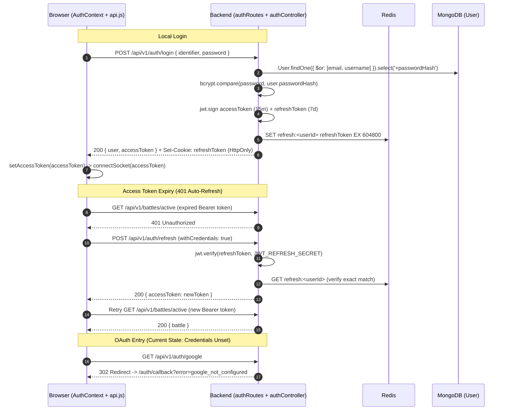

# Module 2: Auth and User

> **Presenter**: Team Member 2 — Identity, Sessions, OAuth Strategies & Player Profiles

---

## 1. Purpose and Scope

The **Auth and User** module owns player identity, authentication, session management, online presence, and user profile CRUD/lookup:
- **Local Authentication**: Registration (`register`), login by username/email (`login`), bcrypt password hashing (`bcryptjs`), and Zod schema validation on signup (`registerSchema`).
- **Session Lifecycle**: Short-lived JWT access tokens kept in frontend memory (`frontend/src/services/api.js`), long-lived JWT refresh tokens stored in Redis (`refresh:<userId>`) and `HttpOnly` cookies (`refreshToken`), automatic 401 refresh deduplication (`api.interceptors.response`), logout revocation (`logout`), and Socket.IO handshake JWT authentication (`backend/src/sockets/index.js`).
- **OAuth 2.0 (Wired, Unconfigured)**: Stateless Passport strategies for Google and GitHub (`passport.js`), CSRF `oauth_state` cookies, verified-email enforcement, account linking by email, and frontend `/auth/callback` session finalization (`AuthCallback.jsx`).
- **User Profiles & Stats**: `User` Mongoose schema (Elo `rating`, `xp`, `stats`, `badges`, `friends`, `isOnline`), tier calculation (`getTier` in `utils/tier.js`), `GET /api/v1/auth/me`, public profile `GET /api/v1/users/:username`, profile editing `PATCH /api/v1/users/me`, `GET /api/v1/users/search`, and frontend `AuthModal.jsx`, `Profile.jsx`, `ProfileDashboard.jsx`, and `ProfileEditor.jsx`.

**What it does NOT own**:
- Rating/XP computation and match history updates (computed by `battleService.finishBattle` and `submissionController.submitCode`, which write to `User`).
- Skiller adaptive practice progress (`SkillerProfile` is owned by **Practice / Skiller**, though `ProfileDashboard.jsx` mounts `<ProfileSkiller />` on a user's own profile).
- **Placeholder features**: `User.friends` exists on the schema and its count renders on `ProfileDashboard.jsx`, but there are no friend-request/add/remove endpoints; `GET /api/v1/users/search` is implemented on the backend but has no UI caller.

---

## 2. Technology Map

| Technology | Role in Auth and User | Exact Files |
| --- | --- | --- |
| **bcryptjs** (`^3.0.3`) | Hashes passwords (`bcrypt.hash(password, 10)`) during signup and verifies them (`bcrypt.compare`) during login. | `backend/src/controllers/authController.js` |
| **jsonwebtoken** (`^9.0.3`) | Signs and verifies `15m` access tokens (`JWT_ACCESS_SECRET`) and `7d` refresh tokens (`JWT_REFRESH_SECRET`). | `backend/src/controllers/authController.js`, `backend/src/middleware/auth.js`, `backend/src/sockets/index.js` |
| **cookie-parser** (`^1.4.7`) | Parses incoming `Cookie` headers into `req.cookies` for `refreshToken` and `oauth_state`. | `backend/src/app.js`, `backend/src/controllers/authController.js` |
| **Zod** (`^3.24.4`) | Validates `register` request body (`username` 3–20 chars, valid `email`, `password` >= 8 chars). | `backend/src/controllers/authController.js` (`registerSchema`) |
| **Passport** (`^0.7.0`) | `passport-google-oauth20` and `passport-github2` strategies with `session: false` and unique username generation. | `backend/src/config/passport.js`, `backend/src/app.js`, `backend/src/controllers/authController.js` |
| **Redis (`ioredis`)** | Stores active refresh tokens (`refresh:<userId>`, 7-day TTL) and Socket.IO active connection counts (`user:connections:<userId>`). | `backend/src/controllers/authController.js`, `backend/src/sockets/index.js` |
| **MongoDB (`Mongoose`)** | Stores `User` documents (`passwordHash` hidden via `select: false` + `toJSON`/`toObject` transforms). | `backend/src/models/User.js`, `backend/src/controllers/userController.js` |
| **Axios + React Context** | `AuthProvider` manages `user`/`loading`/`authModal`; Axios injects Bearer tokens and deduplicates `/auth/refresh` retries. | `frontend/src/context/AuthContext.jsx`, `frontend/src/services/api.js`, `frontend/src/services/socket.js` |
| **React Router + UI** | `ProtectedRoute`, `AuthModal.jsx`, `AuthCallback.jsx`, `Profile.jsx`, `ProfileDashboard.jsx`, `ProfileEditor.jsx`. | `frontend/src/App.jsx`, `frontend/src/components/*`, `frontend/src/pages/*` |

---

## 3. How It Works, Step by Step

### REST Endpoints (`backend/src/routes/authRoutes.js` & `userRoutes.js`)

| Method & Path | Auth | Request Input | Response (`{ success, data }`) | Source |
| --- | --- | --- | --- | --- |
| `POST /api/v1/auth/register` | Public | `{ username, email, password }` | `201`: `{ user, accessToken }` + `Set-Cookie: refreshToken` | `authController.register` |
| `POST /api/v1/auth/login` | Public | `{ identifier \| email \| username, password }` | `200`: `{ user, accessToken }` + `Set-Cookie: refreshToken` | `authController.login` |
| `POST /api/v1/auth/refresh` | Cookie (`refreshToken`) | — | `200`: `{ accessToken }` | `authController.refresh` |
| `POST /api/v1/auth/logout` | Public (reads cookie) | — | `200`: `{ message }` + clears `refreshToken` cookie | `authController.logout` |
| `GET /api/v1/auth/me` | `auth` (Bearer JWT) | — | `200`: `{ user }` (includes computed `rank`, `tier`) | `authController.getMe` |
| `GET /api/v1/auth/google` | Public | — | Redirects to Google OAuth or `/auth/callback?error=google_not_configured` | `authController.googleAuth` |
| `GET /api/v1/auth/google/callback` | `oauth_state` cookie | `?code&state` or `?error` | Sets `refreshToken` cookie, redirects to `/auth/callback` | `authController.googleCallback` |
| `GET /api/v1/auth/github` | Public | — | Redirects to GitHub OAuth or `/auth/callback?error=github_not_configured` | `authController.githubAuth` |
| `GET /api/v1/auth/github/callback` | `oauth_state` cookie | `?code&state` or `?error` | Sets `refreshToken` cookie, redirects to `/auth/callback` | `authController.githubCallback` |
| `GET /api/v1/users/search` | `auth` (Bearer JWT) | `?q=&page=1&limit=10` (max 50) | `{ users, total, page, limit }` (excludes caller) | `userController.searchUsers` |
| `PATCH /api/v1/users/me` | `auth` (Bearer JWT) | `{ username?, bio?, college?, avatar? }` | `{ user }` | `userController.updateMe` |
| `GET /api/v1/users/:username` | Public | `:username` param | `{ user }` (public fields + `rank`, `tier`) | `userController.getUserProfile` |

### Step-by-Step Authentication, Refresh, and OAuth Flows

1. **Initial Page Load (`AuthContext.jsx`)**: `AuthProvider` mounts with `loading = true` and calls `refreshAuth()`, which sends `POST /api/v1/auth/refresh` with `withCredentials: true`. If a valid `refreshToken` cookie matches Redis `refresh:<userId>`, the backend issues a fresh 15-minute `accessToken`. `AuthProvider` stores it in module memory (`setAccessToken(token)` -> also opens Socket.IO), then fetches `GET /api/v1/auth/me` to populate `user` (with `rank` and `tier`).
2. **Sign Up / Log In (`AuthModal.jsx` -> `authController.js`)**: Submitting the modal calls `login()` or `register()` in `AuthContext.jsx`. On success, `authController` sets the `refreshToken` cookie (`httpOnly: true`, `sameSite: 'lax'`, `secure: NODE_ENV === 'production'`, `maxAge: 7d`), stores it in Redis (`refresh:<userId>`, `EX 604800`), returns `{ user, accessToken }`, and the modal navigates to `/dashboard`.
3. **Authenticated REST & Socket Calls**: Every Axios request attaches `Authorization: Bearer <accessToken>` (`api.interceptors.request`). If a request receives `401`, `api.interceptors.response` deduplicates concurrent refreshes via a shared `refreshPromise`, refreshes `/auth/refresh`, updates both Axios and Socket.IO tokens, and retries the original request. Socket.IO (`connectSocket` in `socket.js`) also handles `connect_error` by calling `/auth/refresh` and reconnecting.
4. **OAuth Flow (Wired, Unconfigured)**: Clicking Google/GitHub in `AuthModal` navigates to `/api/v1/auth/google` or `/github`. Currently, `GOOGLE_CLIENT_ID`/`SECRET` and `GITHUB_CLIENT_ID`/`SECRET` are empty in `backend/.env`, so `googleAuth`/`githubAuth` immediately redirect to `${CLIENT_URL}/auth/callback?error=google_not_configured` (or `github_not_configured`), which `AuthCallback.jsx` displays cleanly. If credentials are configured, the server sets a 32-byte random `oauth_state` cookie (`maxAge: 10m`), verifies `state === req.cookies.oauth_state` on callback, looks up or creates the `User` with a verified email, sets the `refreshToken` cookie, and redirects to `/auth/callback`, where `AuthCallback.jsx` calls `refreshAuth()` to obtain an `accessToken` without ever putting tokens in the URL.
5. **Profile & Presence**: `Profile.jsx` loads public data via `GET /api/v1/users/:username` (and `GET /api/v1/submissions/me?limit=5` when viewing your own profile). Editing via `ProfileEditor.jsx` sends `PATCH /api/v1/users/me` and calls `refreshUser()`. Socket connect/disconnect updates `User.isOnline` and `lastSeen` using Redis `user:connections:<userId>`.



---

## 4. Key Code Walkthrough

### Snippet 1: Token Signing & Cookie Configuration (`backend/src/controllers/authController.js`, `generateTokens` & `setRefreshCookie`)

```js
const generateTokens = (userId) => {
  const accessToken = jwt.sign({ userId }, process.env.JWT_ACCESS_SECRET, {
    expiresIn: '15m',
  });
  const refreshToken = jwt.sign({ userId }, process.env.JWT_REFRESH_SECRET, {
    expiresIn: '7d',
  });
  return { accessToken, refreshToken };
};

const setRefreshCookie = (res, token) => {
  res.cookie('refreshToken', token, {
    httpOnly: true,
    sameSite: 'lax',
    secure: process.env.NODE_ENV === 'production',
    maxAge: 7 * 24 * 60 * 60 * 1000,
  });
};
```
- **Why**: Separates a short-lived access token (returned in JSON and held in JS memory) from a long-lived refresh token (locked inside an `HttpOnly` cookie so XSS scripts cannot read it).
- **Non-obvious details**:
  - `expiresIn: '15m'` and `'7d'` are hardcoded here rather than reading `process.env.JWT_ACCESS_EXPIRES_IN` and `process.env.JWT_REFRESH_EXPIRES_IN` from `.env`.
  - `sameSite: 'lax'` allows the cookie to be sent on top-level cross-site OAuth callback redirects while blocking cross-site `POST` CSRF from third-party origins.
  - `app.js` registers `app.use(cookieParser())` **without** `process.env.COOKIE_SECRET`, so `refreshToken` and `oauth_state` are plain `HttpOnly` cookies (integrity relies on JWT signature / random state rather than cookie HMAC signing).

### Snippet 2: Zod Registration Validation & Password Hashing (`backend/src/controllers/authController.js`, `registerSchema` & `register`)

```js
const registerSchema = z.object({
  username: z.string().trim().min(3, 'Username must be at least 3 characters').max(20, 'Username must be at most 20 characters'),
  email: z.string().trim().email('Invalid email address'),
  password: z.string().min(8, 'Password must be at least 8 characters'),
});
// ...
    const parseResult = registerSchema.safeParse(req.body);
    if (!parseResult.success) {
      return res.status(400).json({ message: parseResult.error.errors[0].message });
    }
    // ...
    const passwordHash = await bcrypt.hash(password, 10);

    const user = await User.create({
      username: lowerUsername,
      email: lowerEmail,
      passwordHash,
      authProviders: ['local'],
    });
```
- **Why**: Validates input shape before touching MongoDB and hashes passwords with bcrypt cost `10`.
- **Non-obvious detail**: `register` uses Zod (`registerSchema`), whereas `login` and `updateMe` use manual `if` checks instead of Zod. Notice `registerSchema` does not restrict `username` characters to `[a-z0-9_]` (unlike `generateUniqueUsername` in `passport.js`).

### Snippet 3: OAuth-Only Account Guard on Local Login (`backend/src/controllers/authController.js`, `login`)

```js
    const user = await User.findOne({
      $or: [{ email: cleanIdentifier }, { username: cleanIdentifier }],
    }).select('+passwordHash');

    if (!user) {
      return res.status(401).json({ message: 'Invalid credentials' });
    }

    if (!user.passwordHash) {
      const providers = [];
      if (user.authProviders?.includes('google') || user.googleId) providers.push('Google');
      if (user.authProviders?.includes('github') || user.githubId) providers.push('GitHub');
      const providerText = providers.length > 0 ? providers.join('/') : 'Google/GitHub';
      return res.status(400).json({ message: `This account uses ${providerText} login` });
    }
```
- **Why**: `User.passwordHash` has `select: false` so it is omitted from normal queries; `login` explicitly opts in with `.select('+passwordHash')`.
- **Non-obvious detail**: Accounts created via Google/GitHub have no `passwordHash`. Rather than letting `bcrypt.compare(password, undefined)` throw a 500 error, `login` returns a helpful `400` telling the user which OAuth provider owns the account (which slightly discloses provider linkage for that identifier).

### Snippet 4: Redis-Backed Refresh & Logout (`backend/src/controllers/authController.js`, `refresh` & `logout`)

```js
const refresh = async (req, res) => {
  try {
    const refreshToken = req.cookies.refreshToken;
    if (!refreshToken) {
      return res.status(401).json({ message: 'Refresh token required' });
    }
    let decoded;
    try {
      decoded = jwt.verify(refreshToken, process.env.JWT_REFRESH_SECRET);
    } catch (tokenErr) {
      return res.status(401).json({ message: 'Invalid or expired refresh token' });
    }
    const storedToken = await redis.get(`refresh:${decoded.userId}`);
    if (!storedToken || storedToken !== refreshToken) {
      return res.status(401).json({ message: 'Invalid or expired refresh token' });
    }
    const accessToken = jwt.sign({ userId: decoded.userId }, process.env.JWT_ACCESS_SECRET, {
      expiresIn: '15m',
    });
    return res.json({ success: true, data: { accessToken } });
```
- **Why**: Checking `storedToken === refreshToken` in Redis allows immediate server-side session revocation on `logout` (`redis.del('refresh:' + decoded.userId)`), which pure stateless JWTs cannot do.
- **Non-obvious detail**: `refresh` does **not** rotate the refresh token, and Redis stores a single key per user (`refresh:${userId}`), meaning logging in on a second browser/device overwrites the first session's refresh token (also noted in `backend/README.md` for two-browser testing).

### Snippet 5: OAuth CSRF State & Unconfigured Credential Guard (`backend/src/controllers/authController.js`, `googleAuth` & `googleCallback`)

```js
const googleAuth = (req, res, next) => {
  const clientUrl = process.env.CLIENT_URL || 'http://localhost:5173';
  if (!process.env.GOOGLE_CLIENT_ID || !process.env.GOOGLE_CLIENT_SECRET) {
    return res.redirect(`${clientUrl}/auth/callback?error=google_not_configured`);
  }
  const state = crypto.randomBytes(32).toString('hex');
  res.cookie('oauth_state', state, {
    httpOnly: true,
    sameSite: 'lax',
    secure: process.env.NODE_ENV === 'production',
    maxAge: 10 * 60 * 1000,
  });
  passport.authenticate('google', {
    scope: ['profile', 'email'],
    state,
    session: false,
  })(req, res, next);
};
```
- **Why**: Because `passport.js` registers strategies with placeholder strings when env vars are empty, `googleAuth` and `githubAuth` short-circuit early before redirecting users to Google/GitHub with invalid client IDs.
- **Non-obvious detail**: Using `session: false` avoids `express-session`; instead, a 256-bit random `state` is bound to an `HttpOnly` `oauth_state` cookie and verified in `googleCallback`/`githubCallback` (`state !== savedState`) to block login-CSRF attacks.

### Snippet 6: Verified-Email & Account-Linking Strategy (`backend/src/config/passport.js`, `GitHubStrategy`)

```js
        if (!verifiedEmail && accessToken) {
          try {
            const emailRes = await fetch('https://api.github.com/user/emails', {
              headers: {
                Authorization: `Bearer ${accessToken}`,
                'User-Agent': 'CodingArena',
                Accept: 'application/vnd.github+json',
              },
            });
            if (emailRes.ok) {
              const emailList = await emailRes.json();
              const primary = emailList.find((e) => e.primary && e.verified);
              const any = emailList.find((e) => e.verified);
              verifiedEmail = primary?.email || any?.email || null;
            }
          } catch {}
        }
        if (!verifiedEmail) {
          return done(new Error('email_not_verified'));
        }
```
- **Why**: GitHub users with private email settings omit email from the initial profile object; fetching `/user/emails` retrieves verified emails, and rejecting unverified emails prevents an attacker from hijacking an existing account by registering an unverified email on GitHub/Google.
- **Status note**: Both `GoogleStrategy` and `GitHubStrategy` (plus `googleCallback`/`githubCallback`) are **untested end-to-end** against live providers because OAuth client IDs/secrets are unset in `backend/.env`.

### Snippet 7: Auth Middleware & Bearer Token Check (`backend/src/middleware/auth.js`, `auth`)

```js
const auth = async (req, res, next) => {
  try {
    const authHeader = req.headers.authorization;
    if (!authHeader || !authHeader.startsWith('Bearer ')) {
      return res.status(401).json({ message: 'Authorization token required' });
    }

    const token = authHeader.split(' ')[1];
    const decoded = jwt.verify(token, process.env.JWT_ACCESS_SECRET);

    const user = await User.findById(decoded.userId);
    if (!user) {
      return res.status(401).json({ message: 'User not found' });
    }

    req.user = user;
    next();
  } catch (err) {
    return res.status(401).json({ message: 'Invalid or expired token' });
  }
};
```
- **Why**: Every protected route verifies the signature/expiry of the `Bearer` token and re-fetches the fresh `User` document from MongoDB (`req.user`), ensuring deleted accounts are rejected immediately and handlers always have up-to-date `rating`/`username`.
- **Tradeoff**: Adds 1 MongoDB read per authenticated API request.

### Snippet 8: Single-Flight 401 Refresh Interceptor (`frontend/src/services/api.js`, `api.interceptors.response`)

```js
      try {
        if (!refreshPromise) {
          refreshPromise = axios
            .post(
              `${import.meta.env.VITE_API_URL || "http://localhost:5000/api/v1"}/auth/refresh`,
              {},
              { withCredentials: true }
            )
            .then((res) => {
              const newToken = res.data?.data?.accessToken;
              setAccessToken(newToken);
              return newToken;
            })
            .finally(() => {
              refreshPromise = null;
            });
        }

        const token = await refreshPromise;
        originalRequest.headers.Authorization = `Bearer ${token}`;
        return api(originalRequest);
      } catch (refreshError) {
```
- **Why**: When an access token expires after 15 minutes and a page fires multiple parallel API calls (e.g., `Profile.jsx` or `CommandDeck.jsx`), storing the in-flight `refreshPromise` ensures only **one** `/auth/refresh` request is sent, and all queued 401 requests wait on it and retry with the new token.
- **Non-obvious detail**: `setAccessToken(newToken)` also calls `updateSocketToken(newToken)` (`frontend/src/services/socket.js`) so the Socket.IO client stays synchronized.

---

## 5. Data Model (MongoDB & Redis)

### MongoDB Schema: `User` (`backend/src/models/User.js`)

| Field | Type & Constraints | Purpose |
| --- | --- | --- |
| `username` | `String`, required, `unique`, `trim`, `lowercase`, `minlength: 3`, `maxlength: 20` | Public handle and `/u/:username` route key |
| `email` | `String`, required, `unique`, `trim`, `lowercase` | Login identifier & OAuth account-linking key |
| `passwordHash` | `String`, optional, `select: false` | bcrypt hash (absent for OAuth-only users); stripped in `toJSON`/`toObject` |
| `googleId` / `githubId` | `String`, `unique`, `sparse: true` | Provider subject IDs (sparse allows `undefined` for local users) |
| `authProviders` | `[String]`, default `[]` | Tracks `'local'`, `'google'`, `'github'` |
| `avatar`, `bio`, `college` | `String`, default `''` | Editable public profile fields via `PATCH /users/me` |
| `rating` | `Number`, default `1200` | Competitive Elo rating (mapped to 8 tiers in `utils/tier.js`) |
| `xp` | `Number`, default `0` | Cumulative experience points from problems and battles |
| `badges` | `[String]`, default `[]` | Earned badges (no automated badge-award logic exists yet) |
| `stats` | `{ problemsSolved, submissions, wins, losses, draws, streak, peakRating }` | Aggregate counts (`peakRating` defaults to `1200`) |
| `friends` | `[{ type: ObjectId, ref: 'User' }]` | Placeholder array (read by `ProfileDashboard`, no write endpoints) |
| `isOnline`, `lastSeen` | `Boolean` (`false`), `Date` | Updated by Socket.IO connect/disconnect in `sockets/index.js` |
| `role` | `'user' \| 'admin'`, default `'user'` | Account role (no admin routes exist) |
| `appliedBattleResults` | Implicit array written by `User.collection.updateOne` (`battleService.js`) | Idempotency marker preventing duplicate Elo/XP application (not declared in `userSchema`) |

**Indexes**: Unique indexes on `username`, `email`, sparse unique indexes on `googleId`, `githubId`. (Note: no index on `rating`, even though `getMe`, `getUserProfile`, and `playerRecord` run `User.countDocuments({ rating: { $gt: ... } })` and `searchUsers` sorts by `{ rating: -1 }`.)

### Redis Keys & Cookies

| Storage | Name | Value / Purpose | TTL |
| --- | --- | --- | --- |
| Redis String | `refresh:<userId>` | Active refresh JWT string (overwritten per login/OAuth) | `604800s` (7 days) |
| Redis Integer | `user:connections:<userId>` | Number of open Socket.IO tabs for user (`INCR`/`DECR`) | Deleted when `<= 0` |
| Cookie | `refreshToken` | JWT refresh token (`httpOnly`, `sameSite: 'lax'`, `secure` in prod) | `7 days` |
| Cookie | `oauth_state` | 32-byte hex CSRF nonce (`httpOnly`, `sameSite: 'lax'`) | `10 min` (cleared on callback) |

---

## 6. Security and Failure Handling

- **Password & Token Security**: Passwords hashed with `bcryptjs` (salt rounds `10`); `passwordHash` excluded by `select: false` and stripped in `toJSON`/`toObject` transforms (`User.js`). Access tokens live only in JS memory (`api.js`), never `localStorage`, preventing token theft via `localStorage` reads.
- **Validation**: `register` uses Zod (`registerSchema`). `updateMe` enforces `username` length `3..20` and uniqueness, and trims `bio`/`college`/`avatar` (no length or URL scheme validation on `avatar`/`bio`/`college` in backend).
- **Rate Limits**: **None** on `/auth/register`, `/auth/login`, `/auth/refresh`, or `/users/*`.
- **Auth Middleware**: `middleware/auth.js` protects `/auth/me`, `/users/search`, `/users/me`, plus all battle/submission/skiller routes. Socket.IO (`sockets/index.js`) enforces JWT in `io.use`.
- **OAuth Hardening**: `oauth_state` cookie mitigates login CSRF; `passport.js` refuses unverified provider emails (`email_not_verified`); unconfigured credentials redirect cleanly to `/auth/callback?error=*_not_configured`.
- **Redis Failure Behavior**:
  - `register`, `login`, `refresh`, `googleCallback`, `githubCallback`: `await redis.set` / `redis.get` is **not** wrapped with a status guard, so a Redis outage causes 500 errors (or `server_error` redirect on OAuth).
  - `logout` and `sockets/index.js`: `logout` still clears the cookie if `redis.del` isn't reached only inside `if (refreshToken)`—wait: `await redis.del(...)` is inside `try {} catch {}` so `logout` succeeds even if Redis fails; `sockets/index.js` attaches `.catch(() => {})` on `user:connections` updates.

---

## 7. Limitations and Known Risks

1. **Google & GitHub OAuth credentials unset & untested**: `GOOGLE_CLIENT_ID`/`SECRET` and `GITHUB_CLIENT_ID`/`SECRET` are blank in `backend/.env`, so OAuth callbacks, account linking, and GitHub `/user/emails` fallback have not been verified against live Google/GitHub endpoints.
2. **`COOKIE_SECRET` unused in `app.js`**: `backend/.env` defines `COOKIE_SECRET`, but `backend/src/app.js` calls `app.use(cookieParser())` with no secret argument. Cookies are unsigned (acceptable because `refreshToken` is itself a signed JWT and `oauth_state` is compared against the callback query, though `signedCookies` cannot be used).
3. **Hardcoded JWT lifetimes ignore `.env`**: `generateTokens` and `refresh` in `authController.js` hardcode `'15m'` and `'7d'` rather than reading `JWT_ACCESS_EXPIRES_IN` and `JWT_REFRESH_EXPIRES_IN`.
4. **Single refresh token per user (`refresh:<userId>`)**: Logging in from a second browser or device overwrites the first session's `refreshToken` in Redis, silently logging out the earlier device on its next refresh.
5. **Unescaped `$regex` in `searchUsers`**: `userController.js` line 16 builds `{ $regex: \`^${q}\`, $options: 'i' }` directly from user query `q` without escaping regex metacharacters (`.*+?^${}()|[]\`), risking ReDoS or MongoDB regex errors on malformed input.
6. **No rate limiting on auth endpoints**: `/auth/login` and `/auth/register` have no brute-force or account-enumeration rate limiters.
7. **Missing `rating` index & placeholder features**: `User` has no index on `rating` despite rank `countDocuments({ rating: { $gt: ... } })` queries on `/auth/me`, `/users/:username`, and battle finalization. `friends` and `GET /users/search` have no frontend UI; `avatar` URL has no XSS/scheme check (`javascript:` etc.) beyond `` rendering.

---

## 8. Live Demo Script (3 Minutes + Fallback)

1. **0:00–0:45 — Registration & Zod Validation**: Open `http://localhost:5173`, click **Enter Arena Free** (opens `AuthModal` in signup mode). Enter a 6-char password to show HTML5/server validation, then register a new user (e.g., `demo_user`, `demo@example.com`, `Password123!`). Show redirect to `/dashboard` with `1200 RR` / `Gold` rank badge.
2. **0:45–1:30 — Session Persistence & Token Architecture**: Open Browser DevTools -> *Application -> Cookies* and show the `HttpOnly` `refreshToken` cookie; inspect *Local Storage* to prove no JWT access token is stored there (it lives in JS memory). Refresh the page (`F5`): show `POST /api/v1/auth/refresh` + `GET /api/v1/auth/me` restore the session transparently.
3. **1:30–2:15 — OAuth Honest Status**: Log out, open **Log in**, click **Google** (or **GitHub**). Show the clean redirect to `/auth/callback?error=google_not_configured` and explain that `passport.js` + CSRF `oauth_state` + verified-email linking are implemented while credentials are intentionally unset for local evaluation. Log back in using username (`demo_user`) + password.
4. **2:15–3:00 — Public Profile & Editing**: Click the top-right avatar -> **My profile** (`/u/demo_user`). Click **Edit profile** (`ProfileEditor.jsx`), update `bio` and `college`, click **Save changes** (`PATCH /api/v1/users/me`), and click **Share** to copy the public `/u/demo_user` URL.

**On-stage fallback**: If MongoDB or Redis wasn't restarted cleanly, run `docker compose up -d` in `backend/` and verify `GET http://localhost:5000/health`; if a demo username already exists, append a timestamp or log in with an existing seeded/test account.

---

## 9. Viva Q&A (18 Questions)

### Basic (6)

1. **Why do you issue two tokens (access token and refresh token) instead of one?**
   - *Answer*: The `15m` access token (`authController.generateTokens`) is sent in JSON, kept in JS memory (`api.js`), and sent as a `Bearer` header for fast stateless verification on every REST and Socket.IO request. The `7d` refresh token lives in an `HttpOnly` cookie and Redis (`refresh:<userId>`) so users stay logged in across page reloads without exposing a long-lived credential to JavaScript.

2. **How does `AuthProvider` keep a user logged in on page refresh if `accessToken` is only stored in a JS variable?**
   - *Answer*: On mount (`frontend/src/context/AuthContext.jsx`), `AuthProvider` runs `initAuth()` -> `refreshAuth()`, which calls `POST /api/v1/auth/refresh` with `withCredentials: true`. The browser automatically attaches the `HttpOnly` `refreshToken` cookie, the backend verifies it against Redis, and returns a new `15m` access token followed by `GET /api/v1/auth/me`.

3. **How do users log in with either username or email?**
   - *Answer*: `AuthModal.jsx` sends `{ identifier, password }` to `POST /api/v1/auth/login`. In `authController.login`, the input is trimmed and lowercased into `cleanIdentifier` and queried against MongoDB with `$or: [{ email: cleanIdentifier }, { username: cleanIdentifier }]`.

4. **How are passwords stored and protected from accidental API leaks?**
   - *Answer*: `authController.register` hashes passwords with `bcryptjs` (`bcrypt.hash(password, 10)`). In `backend/src/models/User.js`, `passwordHash` has `select: false` so queries omit it by default, and both `toJSON` and `toObject` schema transforms explicitly `delete ret.passwordHash` so even `.select('+passwordHash')` documents (like during `login`) strip the hash when serialized.

5. **How are ranks/tiers derived from a user's Elo rating?**
   - *Answer*: `backend/src/utils/tier.js` (`getTier`) maps numeric ratings onto eight tiers: `Bronze` (<1000), `Silver` (>=1000), `Gold` (>=1200, the starting rating), `Platinum` (>=1400), `Diamond` (>=1600), `Ascendant` (>=1900), `Immortal` (>=2200), and `Radiant` (>=2500). `authController.getMe` and `userController.getUserProfile` compute `tier` and `rank` (`1 + countDocuments({ rating: { $gt: user.rating } })`) dynamically.

6. **What does `ProtectedRoute` do if an unauthenticated user visits `/dashboard` or `/skiller`?**
   - *Answer*: `frontend/src/components/ProtectedRoute.jsx` waits while `AuthContext` `loading` is `true` (returning `null` so it doesn't flash a redirect before `refreshAuth` finishes). Once `loading` is `false` and `user` is still `null`, its `useEffect` calls `openLogin()` to pop up `AuthModal` and renders `<Navigate to="/" replace />`.

### Intermediate (6)

7. **Why did you store the access token in module memory (`api.js`) instead of `localStorage`?** *(Why X over Y)*
   - *Answer*: Any third-party script or XSS vulnerability on the page can read `localStorage`, stealing long-lived credentials. Keeping `accessToken` in a closure variable inside `frontend/src/services/api.js` prevents direct `localStorage` exfiltration, while the `HttpOnly` `refreshToken` cookie (unreadable by JS) handles persistence across reloads.

8. **Why do you store `refreshToken` in Redis as well as signing it as a JWT?**
   - *Answer*: A pure JWT cannot be revoked before its `7d` expiration without a server-side store. By saving `refresh:<userId>` in Redis on login/register/OAuth and checking `storedToken === refreshToken` in `authController.refresh`, calling `POST /api/v1/auth/logout` deletes the Redis key and immediately invalidates the refresh token.

9. **How does the Axios interceptor avoid firing five `/auth/refresh` requests if five API calls fail with 401 simultaneously?**
   - *Answer*: In `frontend/src/services/api.js`, `api.interceptors.response` caches the active Axios refresh call in a module-level `refreshPromise` variable. Subsequent 401 responses while `refreshPromise` is non-null `await` that same promise instead of issuing new HTTP calls, and `.finally(() => { refreshPromise = null; })` clears it once settled. Note also the URL exclusions (`!url.includes("/auth/refresh")`, `/login`, `/register`) and `_retry` flag to prevent infinite loops.

10. **How does the backend track whether a user is online across multiple open browser tabs?**
    - *Answer*: In `backend/src/sockets/index.js`, every authenticated Socket.IO connection runs `redis.incr('user:connections:' + userId)` and sets `User.isOnline = true` when the count hits `1`. On `disconnect`, it runs `redis.decr` and only sets `isOnline: false` and `lastSeen: new Date()` when `remaining <= 0` (deleting the key). Closing one tab while another remains open keeps the user marked online.

11. **How does Passport handle an OAuth user whose display name collides with an existing username or contains invalid characters?**
    - *Answer*: `generateUniqueUsername` in `backend/src/config/passport.js` lowercases the raw name, strips everything outside `[a-z0-9_]`, pads short names with `'user'` to at least 3 characters, caps at 20 characters, and loops `while (await User.exists({ username }))` appending incrementing numeric suffixes while trimming the base so the total length never exceeds 20.

12. **What happens if a user registers with Google OAuth first and later tries to log in with the local password form?**
    - *Answer*: Because OAuth users are created without `passwordHash`, `authController.login` checks `if (!user.passwordHash)` after fetching the user and returns HTTP `400` with a clear message such as `"This account uses Google login"`, preventing a crash in `bcrypt.compare`. Conversely, if a local user later signs in with Google/GitHub using the same verified email, `passport.js` links `googleId`/`githubId` onto the existing account.

### Hard / Trap (6)

13. **What happens if Redis crashes while users are trying to log in, refresh tokens, or log out?** *(What happens if Z fails)*
    - *Answer*: `authController.register`, `login`, `refresh`, `googleCallback`, and `githubCallback` await `redis.set` or `redis.get` without checking `redis.status` or isolating Redis errors, so a Redis outage returns HTTP `500` (or redirects with `error=server_error`) and blocks new logins and token refreshes. Only `logout` catches errors from `redis.del` so it can still clear the browser's `refreshToken` cookie.

14. **`COOKIE_SECRET` is defined in `backend/.env` and `.env.example`—does `cookie-parser` actually sign your cookies?** *(Trap)*
    - *Answer*: No! In `backend/src/app.js` line 17, `app.use(cookieParser())` is called with **no arguments**, so `COOKIE_SECRET` is currently unused. That means `refreshToken` and `oauth_state` are plain `HttpOnly` cookies (read via `req.cookies`, not `req.signedCookies`); security still holds because `refreshToken` is itself a signed JWT and `oauth_state` is a 256-bit random nonce, though passing `process.env.COOKIE_SECRET` would add HMAC cookie signing.

15. **What happens if a user logs in on Chrome and Firefox at the same time?** *(Trap)*
    - *Answer*: In `authController.js`, Redis stores only one string per user under `refresh:${userId}`. The second login overwrites the first login's `refreshToken` in Redis, so as soon as Chrome's `15m` access token expires and it calls `/auth/refresh`, `storedToken !== refreshToken` fails with `401` and Chrome is logged out. Supporting multi-device sessions would require storing per-session token IDs (`jti`) in a Redis set or hash instead of a single key.

16. **Are there any input validation or security gaps in `userController.js` or `authController.js`?**
    - *Answer*: Yes, three concrete ones: (1) `userController.searchUsers` passes raw `req.query.q` into `{ $regex: \`^${q}\`, $options: 'i' }` without escaping regex metacharacters, allowing malformed regexes or slow backtracking; (2) `authRoutes` has no rate limiting on `/login` or `/register`, leaving them open to brute-force attempts; and (3) `updateMe` accepts arbitrary `avatar` strings without URL/protocol validation (`http:`/`https:`), unlike Skiller's `parseProfile` which enforces `https:`.

17. **How would you scale Auth and User horizontally across multiple backend servers?** *(How would you scale this)*
    - *Answer*: HTTP auth endpoints (`/login`, `/refresh`, `/me`) are already horizontally scalable because refresh state lives in shared Redis and JWT verification uses a shared secret. To scale cleanly, we should: (a) add a MongoDB index on `User.rating` so rank counts don't scan the collection as users grow; (b) replace single-key `refresh:<userId>` with `refresh:<userId>:<sessionId>` keys; (c) add Redis-backed rate limiting on `/login` and `/register`; and (d) validate/sanitize `user:connections:<userId>` cleanup on node crashes (e.g., TTL heartbeats instead of relying solely on `disconnect` events).

18. **What is the weakest part of the Auth and User module right now?** *(Weakest part)*
    - *Answer*: The weakest operational aspect is the **unconfigured and untested OAuth integration** combined with **missing auth rate limiting and single-session Redis keys**. Because `GOOGLE_CLIENT_ID`/`GITHUB_CLIENT_ID` are blank in `.env`, the entire Passport callback, GitHub email fetch, and `AuthCallback` handoff have never been tested live; meanwhile, `authController.js` hardcodes `'15m'`/`'7d'` ignoring `.env`, `COOKIE_SECRET` is unwired in `app.js`, and `searchUsers` has an unescaped `$regex`.
