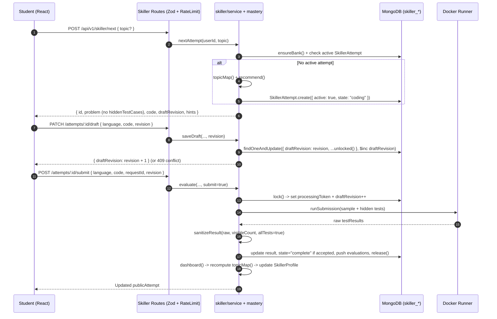

# Module 3: Practice (Skiller)

> **Presenter**: Team Member 3 — Adaptive DSA Practice, Mastery Scoring & Coding Profile Connectors

---

## 1. Purpose and Scope

The **Practice (Skiller)** module owns self-paced, adaptive Data Structures & Algorithms (DSA) practice at `/skiller`, `/skiller/practice/:attemptId`, and `/api/v1/skiller/*`:
- **Self-Contained Curriculum**: 24 original problems across 6 topics (`arrays`, `strings`, `hashing`, `binary-search`, `stacks`, `dynamic-programming` — 4 per topic: 2 easy, 1 medium, 1 hard) lazily installed via idempotent upserts (`ensureBank` in `backend/src/skiller/service.js`).
- **Adaptive Recommendation & Mastery Engine**: Computes per-topic strength scores (`topicMap` in `mastery.js`) from distinct solved problems, hints, and retries, and picks the next question (`recommend`) prioritizing `needs-practice -> unassessed -> improving -> strong`.
- **Resumable Practice Workspace**: Single-active-attempt enforcement (`one_active_skiller_attempt`), optimistic draft locking (`draftRevision`), evaluation leases (`LEASE_MS = 120000`), idempotent `requestId` evaluation records, progressive hints (`revealHint`), skip/exit flows, and paginated history.
- **External Coding Profile Connectors**: Allowlisted HTTPS profile linking for LeetCode, GeeksforGeeks, and CodeChef (`profiles.js`), with best-effort public topic-count import from LeetCode's GraphQL API.
- **Backend Diagnostic Endpoints**: `GET /api/v1/skiller/diagnostic` and `POST /api/v1/skiller/diagnostic` (12 MCQs) remain wired in backend and `services/skiller.js` to bootstrap `priorFor` scores, though the current UI (`Skiller.jsx`, `ProfileSkiller.jsx`) goes straight to adaptive coding practice.

**What it does NOT own**:
- Ranked 1v1 matchmaking, Elo rating (`rating`), XP (`xp`), or `Battle` records (Skiller never mutates `User.rating`, `User.xp`, or `User.stats`, and uses three separate MongoDB collections: `skiller_problems`, `skiller_profiles`, `skiller_attempts`).
- Docker container implementation (reuses `runSubmission` from `backend/src/services/codeRunnerService.js` and `sanitizeStarterCode`/`isLegacySolved` from `starterCode.js` without modifying them).
- AI / LLM calls (Skiller requires **no** LLM API key; older `state: 'interview'` attempts are auto-completed on read via `finishLegacyInterviews`).

---

## 2. Technology Map

| Technology | Role in Practice (Skiller) | Exact Files |
| --- | --- | --- |
| **Express 4** | REST router mounted at `/api/v1/skiller` with centralized `route()` and `body()` wrappers. | `backend/src/routes/index.js`, `backend/src/skiller/routes.js` |
| **Zod** (`^3.24.4`) | Strict validation for `language`, `provider`, `requestId` regex, non-empty `source` (`<= 20000` chars), `revision`, diagnostic answers, and profile URLs. | `backend/src/skiller/routes.js` |
| **MongoDB (`Mongoose`)** | Three dedicated collections (`skiller_problems`, `skiller_profiles`, `skiller_attempts`), partial unique index `one_active_skiller_attempt`, optimistic `draftRevision`, and `processingToken` leases. | `backend/src/skiller/models.js`, `backend/src/skiller/service.js` |
| **Redis + In-Memory Fallback** | Per-user, per-scope fixed-window rate limiting (`skiller:limit:<scope>:<userId>`) falling back to an in-memory `Map` if Redis is unavailable. | `backend/src/skiller/routes.js` (`limit`) |
| **Docker Runner** | Executes sample cases (`/run`) and sample + hidden cases (`/submit`) via `codeRunnerService.runSubmission`. | `backend/src/services/codeRunnerService.js`, `backend/src/skiller/service.js` |
| **Fetch (`AbortSignal.timeout`)** | Best-effort public LeetCode GraphQL topic import with `redirect: 'error'`, `8000ms` timeout, and `512000`-byte streaming cap. | `backend/src/skiller/profiles.js` (`importPublicTopics`) |
| **React 19 + Hooks** | `Skiller.jsx` (5s selection screen), `SkillerPractice.jsx` (IDE + test panel), `useSkillerDraft.js` (1.2s debounce + `sessionStorage`), `ProfileSkiller.jsx` (dashboard + history + profile links). | `frontend/src/pages/Skiller.jsx`, `SkillerPractice.jsx`, `frontend/src/hooks/useSkillerDraft.js`, `frontend/src/components/ProfileSkiller.jsx`, `frontend/src/services/skiller.js` |

---

## 3. How It Works, Step by Step

### REST Endpoints (`backend/src/skiller/routes.js`, all guarded by `auth`)

| Method & Path | Rate Limit | Input Validation (Zod) | Response (`{ success, data }`) | Source |
| --- | --- | --- | --- | --- |
| `GET /api/v1/skiller` | — | — | `{ topics, weakTopics, links, diagnosticCompleted, bankCount, stats, activeAttempt, recentAttempts }` | `service.dashboard` |
| `GET /api/v1/skiller/history` | — | `?page=1&limit=8` (`limit` 1–50) | `{ attempts, total, page, pages, limit }` | `service.history` |
| `GET /api/v1/skiller/diagnostic` | — | — | `{ questions }` (12 MCQs without answers) | `service.diagnostic` |
| `POST /api/v1/skiller/diagnostic` | `5/60s` | `{ answers: [{ questionId, option }] }` (len 12) | `{ dashboard, results }` | `service.saveDiagnostic` |
| `PUT /api/v1/skiller/profiles/:provider` | `6/60s` | `provider`: `leetcode\|gfg\|codechef`; `{ url }` | `{ link, dashboard }` | `service.saveLink` |
| `DELETE /api/v1/skiller/profiles/:provider` | — | `provider` enum | Updated `dashboard` | `service.removeLink` |
| `POST /api/v1/skiller/next` | `20/60s` | `{ topic? }` (6-topic enum) | `publicAttempt` (resumes active or creates new) | `service.nextAttempt` |
| `GET /api/v1/skiller/attempts/:id` | — | `:id` ObjectId | `publicAttempt` (refreshes dashboard first) | `service.getAttempt` |
| `PATCH /api/v1/skiller/attempts/:id/draft` | `90/60s` | `{ language, code, revision }` | `{ draftRevision }` (or `409` on mismatch) | `service.saveDraft` |
| `POST /api/v1/skiller/attempts/:id/hint` | `20/60s` | — | Updated `publicAttempt` with next hint | `service.revealHint` |
| `POST /api/v1/skiller/attempts/:id/run` | `10/60s` | `{ language, code, requestId, revision }` | Updated `publicAttempt` (`lastRun` populated) | `service.evaluate(..., false)` |
| `POST /api/v1/skiller/attempts/:id/submit` | `10/60s` | `{ language, code, requestId, revision }` | Updated `publicAttempt` (`result`, `state: 'complete'` if solved) | `service.evaluate(..., true)` |
| `POST /api/v1/skiller/attempts/:id/abandon` | `20/60s` | — | Updated `dashboard` (`state: 'abandoned'`) | `service.abandon` |

### Step-by-Step User & Data Flow

1. **Profile Journey & Linking (`ProfileSkiller.jsx`)**: Viewing your own `/u/:username` calls `GET /api/v1/skiller`, which runs `ensureBank()` (inserts any missing problems from the 24-problem bank without overwriting existing ones), `topicMap()`, and persists `weakTopics`, `topicStrengths`, and `practiceStats` on `SkillerProfile`. Optionally, the student links LeetCode/GFG/CodeChef via `PUT /api/v1/skiller/profiles/:provider`; LeetCode fetches public `tagProblemCounts` to estimate an initial prior (`20..60`).
2. **Question Selection (`Skiller.jsx` -> `service.nextAttempt`)**: Navigating to `/skiller` (optionally `?topic=arrays`) triggers `POST /api/v1/skiller/next` alongside a 5-second visual stepper (`SELECTION_DELAY_MS = 5000`). If an `active: true` attempt already exists, it is immediately resumed (ignoring `?topic` so users cannot farm skips). Otherwise `recommend()` picks the highest-priority topic (`needs-practice -> unassessed -> improving -> strong`), targets difficulty `easy (0)`, `medium (1)` if `uniqueSolved >= 2`, or `hard (2)` if `strong`, and prefers problems unused or used longest ago. Once created, the client navigates to `/skiller/practice/:attemptId`.
3. **Editing & Optimistic Draft Sync (`useSkillerDraft.js` -> `service.saveDraft`)**: Typing caches code per language in `sessionStorage` (`skiller-editor:<userId>:<attemptId>`) and debounces `PATCH /draft` by `1200ms` via a serialized Promise `chain`, passing `revision`. If another tab modified the attempt, MongoDB rejects the mismatched `draftRevision` with `409`, locking the editor until reloaded.
4. **Hints, Sample Runs, and Full Submissions (`SkillerPractice.jsx` -> `service.evaluate`)**:
   - Clicking *Hint* calls `POST /hint` and appends the next index to `hintsUsed` (each hint deducts `12` from that problem's quality score).
   - Clicking *Run samples* (`Ctrl+Enter`) or *Submit solution* (`Alt+Enter`) first awaits `draft.flush()`, then sends `POST /run` or `/submit` with a UUID `requestId`. The backend checks `evaluations` for an idempotent replay, acquires a 120s `processingToken` lease (`lock()`), runs Docker (`runSubmission`), sanitizes output (`sanitizeResult`), and releases the lease in `finally`.
   - On full pass (`submit && accepted`), `state` becomes `'complete'`, `active` becomes `false`, and `getAttempt` triggers `dashboard()` to recompute `SkillerProfile` topic strengths.
5. **Skip & Exit**: *Skip* flushes the draft, calls `POST /abandon` (`active: false`, `state: 'abandoned'`), and navigates to `/skiller` for a new question. *Exit* flushes the draft (keeping `active: true` so it resumes later) and returns to `/`; if syncing fails, `SkillerPractice.jsx` lets the user retry or *Exit without syncing* while preserving the local `sessionStorage` copy.



---

## 4. Key Code Walkthrough

### Snippet 1: Mastery Score & `strong` Classification (`backend/src/skiller/mastery.js`, `topicMap`)

```js
    const recent = groups.map((item) => item.latest).sort((a, b) => timestamp(a.updatedAt || a.startedAt) - timestamp(b.updatedAt || b.startedAt)).slice(-10);
    const prior = priorFor(topic.id, profile);
    let score = prior.score;
    if (recent.length) {
      const weighted = recent.reduce((sum, attempt, index) => {
        const accepted = attempt.result.status === 'accepted';
        let quality = accepted ? Math.max(40, 95 - (attempt.hintsUsed?.length || 0) * 12 - Math.max(0, attempt.submissions - 1) * 6) : 20 + 25 * ((attempt.result.passedCount || 0) / Math.max(1, attempt.result.totalCount || 0));
        return sum + quality * (index + 1);
      }, 0) / (recent.length * (recent.length + 1) / 2);
      score = recent.length < 3 && prior.score != null ? weighted * .7 + prior.score * .3 : weighted;
    }
    const solved = groups.filter((item) => item.solved).length, independent = groups.filter((item) => item.independent).length;
    let streak = 0;
    for (const attempt of [...recent].reverse()) { if (attempt.result.status !== 'accepted') break; streak++; }
    const status = score == null ? 'unassessed' : solved >= 3 && independent >= 2 && score >= 70 && streak >= 2 ? 'strong' : score >= 45 ? 'improving' : 'needs-practice';
```
- **Why**: Groups attempts by `problemId` so re-solving the same easy problem 10 times cannot inflate `uniqueSolved` or topic score.
- **Line-by-line**:
  - `independent`: requires `accepted`, `hintsUsed.length === 0`, and `submissions <= 2`.
  - Quality per solved problem starts at `95`, minus `12` per hint and `6` per retry after the first submission (floored at `40`); unsolved attempts score `20 + 25 * passRatio`.
  - Linear recency weights `(index + 1)` over the last 10 distinct problems give newer solves more impact; when `< 3` problems are tried and a diagnostic/LeetCode `prior` exists, it blends `70%` practice + `30%` prior.
  - Earning `'strong'` requires all four gates: `solved >= 3`, `independent >= 2`, `score >= 70`, and a trailing solve `streak >= 2`.

### Snippet 2: Adaptive Question Recommendation (`backend/src/skiller/mastery.js`, `recommend`)

```js
  const priority = { 'needs-practice': 0, unassessed: 1, improving: 2, strong: 3 };
  const sorted = [...topics].sort((a, b) => (a.id === requestedTopic ? -1 : b.id === requestedTopic ? 1 : priority[a.status] - priority[b.status] || (a.score ?? 0) - (b.score ?? 0) || timestamp(a.lastPracticedAt) - timestamp(b.lastPracticedAt)));
  const due = sorted.find((topic) => topic.status === 'strong' && now - timestamp(topic.lastPracticedAt) >= 7 * 86400000);
  if (!requestedTopic && due && random() < .2) sorted.unshift(sorted.splice(sorted.indexOf(due), 1)[0]);
  for (const topic of sorted) {
    const choices = problems.filter((problem) => problem.topic === topic.id && !solved.has(String(problem._id)));
    if (!choices.length) continue;
    const level = topic.status === 'strong' ? 2 : topic.uniqueSolved >= 2 ? 1 : 0;
    const distance = Math.min(...choices.map((problem) => Math.abs(DIFFICULTIES.indexOf(problem.difficulty) - level)));
    const suitable = choices.filter((problem) => Math.abs(DIFFICULTIES.indexOf(problem.difficulty) - level) === distance);
    const oldest = Math.min(...suitable.map((problem) => lastUsed.get(String(problem._id)) || 0));
    const pool = suitable.filter((problem) => (lastUsed.get(String(problem._id)) || 0) === oldest);
    const picked = pool[Math.min(pool.length - 1, Math.floor(random() * pool.length))];
```
- **Why**: Deterministic-yet-varied topic and difficulty progression.
- **Non-obvious details**:
  - Weakest topics (`needs-practice`) come first, followed by `unassessed`, `improving`, and `strong`—unless the user explicitly selected `?topic=...`.
  - If no topic was requested and a `strong` topic hasn't been practiced in 7+ days, there is a 20% spaced-repetition chance (`random() < .2`) to surface a hard challenge from it.
  - `oldest` ensures unseen problems (`lastUsed === 0`) are always preferred over recently skipped ones. Once all 24 problems are solved, `recommend` falls back to `kind: 'review'`.

### Snippet 3: Optimistic Locking, Leases & Request Idempotency (`backend/src/skiller/service.js`, `lock` & `evaluate`)

```js
function unlocked() { return { $or: [{ processingAt: null }, { processingAt: { $lt: new Date(Date.now() - LEASE_MS) } }] }; }
async function lock(user, id, state, revision) {
  const token = randomUUID();
  const record = await SkillerAttempt.findOneAndUpdate({ _id: id, user, active: true, state, ...(revision == null ? {} : { draftRevision: revision }), ...unlocked() }, { $set: { processingAt: new Date(), processingToken: token } }, { new: true });
  if (!record) throw error(409, 'This attempt is locked or another request is still running. Refresh the attempt before retrying.');
  return token;
}
async function release(id, token) { await SkillerAttempt.updateOne({ _id: id, processingToken: token }, { $set: { processingAt: null, processingToken: null } }); }
// ...
async function evaluate(user, id, input, submit) {
  const attempt = await ownedAttempt(user, id), kind = submit ? 'submit' : 'run';
  if (attempt.evaluations.some((entry) => entry.requestId === input.requestId && entry.kind === kind)) return getAttempt(user, id);
  const token = await lock(user, id, 'coding', input.revision);
  try {
    await SkillerAttempt.updateOne({ _id: id, processingToken: token }, { $set: { code: input.code, language: input.language }, $inc: { draftRevision: 1 } });
```
- **Why**: Prevents double-clicks, stale tabs, and HTTP retries from corrupting submission counts or running concurrent Docker jobs for one attempt.
- **Non-obvious detail**:
  - `requestId` check returns the saved attempt immediately if a network retry replays an already-completed run/submit.
  - `LEASE_MS` (120 seconds) ensures that if the Node server crashes mid-Docker execution, the attempt automatically becomes unlocked after 2 minutes rather than staying permanently wedged.
  - `release` matches `processingToken: token`, so a slow timed-out request cannot accidentally clear a newer lease.

### Snippet 4: Hidden-Test Output Redaction (`backend/src/skiller/service.js`, `sanitizeResult`)

```js
function sanitizeResult(raw, visibleCount, allTests) {
  const text = (value) => value == null ? '' : String(value).slice(0, 6000);
  return {
    status: raw.status, passedCount: raw.passedCount || 0, totalCount: raw.totalCount || 0, executionTimeMs: raw.executionTimeMs || 0,
    error: !allTests ? text(raw.error) : raw.error ? 'A test could not complete. Run the samples for visible debugging details.' : '',
    // Full submissions share the executor's files across cases. Even sample
    // stdout or compiler diagnostics can contain hidden data printed by code.
    testResults: (raw.testResults || []).map((test, index) => ({ passed: !!test.passed, timeMs: test.timeMs || 0, hidden: allTests && index >= visibleCount, ...(!allTests ? { output: text(test.output), expected: text(test.expectedOutput ?? test.expected), error: text(test.error) } : {}) })),
  };
}
```
- **Why**: As the inline comment explains, `codeRunnerService` mounts a single `tmpDir` containing `in_0.txt..in_k.txt` into `/app`. During a full `submit` (`allTests === true`), malicious user code could read `/app/in_3.txt` (a hidden test) and print it to stdout on sample case `0` (or trigger a compile error containing it). Stripping `output`, `expected`, `error`, and compiler logs from *all* test cases when `allTests === true` closes that side channel.

### Snippet 5: SSRF-Safe Profile URL Parser & Bounded GraphQL Fetch (`backend/src/skiller/profiles.js`, `parseProfile` & `importPublicTopics`)

```js
const HOSTS = { leetcode: ['leetcode.com', 'www.leetcode.com'], gfg: ['geeksforgeeks.org', 'www.geeksforgeeks.org', 'auth.geeksforgeeks.org'], codechef: ['codechef.com', 'www.codechef.com'] };
// ...
function parseProfile(provider, input) {
  if (!HOSTS[provider]) throw Object.assign(new Error('Choose LeetCode, GeeksforGeeks, or CodeChef.'), { status: 400 });
  let url;
  try { url = new URL(String(input)); } catch { throw Object.assign(new Error('Enter a complete HTTPS profile URL.'), { status: 400 }); }
  if (url.protocol !== 'https:' || url.username || url.password || url.port || !HOSTS[provider].includes(url.hostname.toLowerCase())) throw Object.assign(new Error('Use a public HTTPS profile link from the selected platform.'), { status: 400 });
  const parts = url.pathname.split('/').filter(Boolean);
  const username = provider === 'leetcode' ? parts[0] === 'u' && parts.length === 2 ? parts[1] : parts.length === 1 ? parts[0] : null : provider === 'codechef' ? parts[0] === 'users' && parts.length === 2 ? parts[1] : null : ['user', 'profile'].includes(parts[0]) && parts.length === 2 ? parts[1] : null;
  if (!username || !/^[a-zA-Z0-9_-]{1,60}$/.test(username)) throw Object.assign(new Error('That URL does not look like a user profile.'), { status: 400 });
  const canonical = provider === 'leetcode' ? `https://leetcode.com/u/${username}/` : provider === 'codechef' ? `https://www.codechef.com/users/${username}` : `https://www.geeksforgeeks.org/user/${username}/`;
  return { provider, username, url: canonical, linkedAt: new Date() };
}
```
- **Why**: Never fetches arbitrary user-supplied URLs (preventing Server-Side Request Forgery). It extracts only an alphanumeric `username`, canonicalizes the URL, and `importPublicTopics` only ever POSTs to the hardcoded `https://leetcode.com/graphql/` endpoint with `redirect: 'error'`, an 8s timeout, and a 512 KB response cap.

### Snippet 6: Redis-with-Memory-Fallback Rate Limiter (`backend/src/skiller/routes.js`, `limit`)

```js
const fallback = new Map();
function limit(scope, maximum) {
  return async (req, res, next) => {
    const key = `skiller:limit:${scope}:${req.user._id}`;
    try {
      if (redis.status === 'ready') { const count = await redis.incr(key); if (count === 1) await redis.expire(key, 60); if (count > maximum) return res.status(429).json({ message: 'Too many Skiller requests. Try again in a minute.' }); return next(); }
    } catch {}
    const now = Date.now();
    for (const [entry, value] of fallback) if (value.until <= now) fallback.delete(entry);
    const bucket = fallback.get(key) || { count: 0, until: now + 60000 }; bucket.count++; fallback.set(key, bucket);
    if (bucket.count > maximum) return res.status(429).json({ message: 'Too many Skiller requests. Try again in a minute.' });
    next();
  };
}
```
- **Why**: Unlike `middleware/rateLimit.js` (which fails open on Redis outage), Skiller falls back to a local `Map` with expired-entry sweeping so rate limits stay active even when Redis is disconnected.

---

## 5. Data Model (`backend/src/skiller/models.js` & Rate Limit Keys)

1. **`SkillerProblem` (`skiller_problems`)**
   - `slug` (`unique`), `title`, `topic` (`arrays | strings | hashing | binary-search | stacks | dynamic-programming`), `difficulty` (`easy | medium | hard`), `description`, `inputFormat`, `outputFormat`, `constraints`, `sampleTestCases`, `hiddenTestCases` (`select: false`), `hints` (`select: false`), `starterCode`, `timeLimitMs` (`2000`), `memoryLimitMb` (`256`), `version` (`1`).

2. **`SkillerProfile` (`skiller_profiles`)**
   - `user` (unique ref `User`), `links` (`[{ provider, username, url, status, message, linkedAt, importedAt, topicCounts }]`), `diagnostic` (`{ completedAt, answers }`), `weakTopics`, `topicStrengths` (cached scores/status/confidence/counts), `practiceStats` (`{ uniqueSolved, attempts, submissions, sampleRuns, strongTopics }`), `progressUpdatedAt` (monotonic guard against stale dashboard overwrites).

3. **`SkillerAttempt` (`skiller_attempts`)**
   - `user`, `problem` (ref `SkillerProblem`), `topic`, `difficulty`, `kind` (`practice | review`), `reason`, `active` (`Boolean`, default `true`), `state` (`coding | interview | complete | abandoned`), `language`, `code` (`select: false`), `draftRevision`, `runs`, `submissions`, `hintsUsed`, `startedAt`, `completedAt`, `elapsedMs`, `acceptedAt`, `result`, `lastRun`, `evaluations` (`select: false`, capped at 200), `processingAt`, `processingToken` (`select: false`), `interview` (legacy read-only field).
   - **Indexes**: `{ user: 1 }` with `{ unique: true, partialFilterExpression: { active: true }, name: 'one_active_skiller_attempt' }` (prevents concurrent `/next` calls from assigning two active problems) and `{ user: 1, createdAt: -1 }`.

4. **Redis Keys**: `skiller:limit:<scope>:<userId>` (`INCR`, `60s` TTL for `diagnostic`, `profiles`, `next`, `draft`, `hint`, `evaluate`, `abandon`), falling back to in-memory `Map` if Redis is not `'ready'`.

---

## 6. Security and Failure Handling

- **Account Isolation & Hidden Data**: `router.use(auth)` protects every Skiller route. `ownedAttempt` filters by `{ _id: id, user }`. `hiddenTestCases`, `hints`, `code`, `evaluations`, and `processingToken` are `select: false` and never leaked in `publicProblem` or `history()`. `sanitizeResult` strips stdout/stderr/expected output on full submissions (`allTests: true`).
- **Validation & SSRF**: Zod validates every request body/provider. `parseProfile` restricts profile URLs to `https:` allowlisted domains with no credentials/ports, and `importPublicTopics` disables HTTP redirects and enforces an 8s timeout + 512 KB cap.
- **Draft & Evaluation Resilience**: `useSkillerDraft.js` stores unsaved work in `sessionStorage` and serializes saves via `draftRevision`. If `PATCH /draft` or `POST /submit` hits a `409` conflict, the editor locks safely and prompts the user to reload. `LEASE_MS` (120s) recovers stuck `processingAt` locks if the server crashes mid-run.
- **Upstream / Redis Failure**: LeetCode import failures degrade gracefully (`status: 'unavailable'`, keeping any prior imported counts). Redis failures degrade to in-memory rate limiting (`fallback` `Map`), and Skiller requires zero LLM access.

---

## 7. Limitations and Known Risks

1. **Docker runner concurrency & load untested**: Shares `codeRunnerService.ExecutionQueue(3)` with 1v1 Duel; heavy concurrent practice + duel load is untested.
2. **No diagnostic UI in frontend**: `GET/POST /api/v1/skiller/diagnostic` and `.sk-diagnostic` CSS exist, but `Skiller.jsx` and `ProfileSkiller.jsx` do not expose the 12-question diagnostic quiz in the UI (only LeetCode import or practice attempts seed topic scores).
3. **GFG and CodeChef topic import unimplemented**: `profiles.js` explicitly saves links only (`status: 'linked'`) for GeeksforGeeks and CodeChef without importing solved counts.
4. **Fixed 24-problem bank**: `ensureBank()` installs 24 problems (`$setOnInsert`); once all 24 are solved, `recommend()` enters `'review'` mode and does not generate new problems.
5. **Hidden test info in single-container `runner.sh` mitigated only by stripping output**: As `service.js` notes, test inputs `in_*.txt` sit together in `/app`; stripping all `testResults` details on `submit` mitigates exfiltration, though a user could still encode a small bit via exit status/time limit.

---

## 8. Live Demo Script (3 Minutes + Fallback)

1. **0:00–0:45 — Profile Journey & LeetCode Link**: Open `/u/<your-username>` (`ProfileDashboard`), scroll to **Your Skiller journey** (`ProfileSkiller.jsx`). Expand **Topic progress** (showing unassessed/weak topics) and **Coding profiles**; link a public LeetCode profile (`https://leetcode.com/u/<name>/`) to show topic-count import (or graceful *Import unavailable* fallback if offline).
2. **0:45–1:30 — Adaptive Selection**: Click **Start practice** -> `/skiller` shows the 5-second selection animation (`Skiller.jsx`) and opens `/skiller/practice/:attemptId`. Point out the recommendation reason, problem statement, and `Hints` button.
3. **1:30–2:30 — Hint, Draft Sync, Run Samples & Full Submit**: Write an incorrect solution, pause 1.5s to show `"Saved to your account"`, click *Run samples* (`Ctrl+Enter`) to inspect sample output, reveal 1 hint, then fix and click *Submit solution* (`Alt+Enter`). Show immediate completion notice (*"Solved. Your progress is saved."*) while ranked `RR` remains untouched.
4. **2:30–3:00 — Updated Mastery & History**: Return to `/u/<username>` (`ProfileSkiller`) and show updated **Topic progress** meter (`score/100`), **Solved** counter, and paginated **Practice history**. Also mention `node --test scripts/skiller.test.cjs` verifies all 24 problems + mastery rules.

**On-stage fallback**: If LeetCode GraphQL is unreachable in the venue network, show the *"Public topic import is unavailable"* status message (proving graceful degradation) and proceed directly to `/skiller` which works offline with local Docker + MongoDB.

---

## 9. Viva Q&A (18 Questions)

### Basic (6)

1. **Why is Skiller kept in separate collections (`skiller_problems`, `skiller_profiles`, `skiller_attempts`) instead of reusing `Problem` and `Submission`?**
   - *Answer*: Keeping separate collections (`backend/src/skiller/models.js`) guarantees that practice runs, hints, skips, and retries never pollute ranked 1v1 problems, `User.rating`, `User.xp`, or ranked `Submission` counts. It also lets Skiller attach topic/difficulty metadata, `draftRevision`, `processingToken`, and `hints` cleanly without altering ranked schemas.

2. **How are the 24 Skiller problems loaded into MongoDB?**
   - *Answer*: `ensureBank()` (`backend/src/skiller/service.js`) runs lazily on the first dashboard, diagnostic, profile-link, or `nextAttempt` request and executes `SkillerProblem.bulkWrite` with `{ updateOne: { filter: { slug }, update: { $setOnInsert: problem }, upsert: true } }`. Because it uses `$setOnInsert`, existing problem documents are never overwritten and no manual seed script is required.

3. **What are the 6 topics and 4 topic statuses in Skiller?**
   - *Answer*: The 6 topics (`backend/src/skiller/curriculum.js`) are `arrays`, `strings`, `hashing`, `binary-search`, `stacks`, and `dynamic-programming` (4 problems each: 2 easy, 1 medium, 1 hard). `topicMap` (`mastery.js`) classifies each topic as `unassessed` (no score), `needs-practice` (`score < 45`), `improving` (`45 <= score < 70` or missing a `strong` gate), or `strong` (`solved >= 3 && independent >= 2 && score >= 70 && streak >= 2`).

4. **What is the difference between "Skip" and "Exit" in the practice workspace?**
   - *Answer*: *Exit* (`exitPractice` in `SkillerPractice.jsx`) flushes the current code draft to MongoDB via `PATCH /draft` while keeping `active: true` and `state: 'coding'`, so clicking *Continue practice* later resumes the exact same question. *Skip* (`nextQuestion(true)`) flushes the draft, calls `POST /abandon` (`active: false`, `state: 'abandoned'`), and immediately requests a new question from `/skiller`.

5. **Does practicing on Skiller affect a player's ranked Elo rating or XP?**
   - *Answer*: No. None of the functions in `backend/src/skiller/service.js` write to the `User` collection. Ranked `rating` and `xp` are updated only by `battleService.finishBattle` and `submissionController.submitCode`.

6. **How does Skiller prevent a student from earning hints or inflating scores by re-solving the same problem?**
   - *Answer*: `topicMap` (`mastery.js`) groups attempts by `problemId` into a `Map`, tracking only the latest attempt per distinct problem for scoring and counting `uniqueSolved` once per problem. Even in `'review'` mode (after solving all 24 problems), `recommend` explicitly notes that unique-solve totals remain unchanged.

### Intermediate (6)

7. **Why does Skiller store `draftRevision` on `SkillerAttempt` instead of blindly overwriting `code` on every `PATCH /draft`?** *(Why X over Y)*
   - *Answer*: Without optimistic concurrency (`draftRevision` in `service.saveDraft` and `lock`), two open browser tabs—or a slow debounced draft arriving after a submission—could silently overwrite newer code or evaluate stale code. By matching `draftRevision: revision` in `findOneAndUpdate` and incrementing it on every draft save and evaluation, stale writes fail with HTTP `409` so the user is warned rather than losing work.

8. **How does `SkillerAttempt` guarantee only one active practice problem per user even under concurrent clicks?**
   - *Answer*: In `backend/src/skiller/models.js`, `attemptSchema` defines a partial unique MongoDB index `{ user: 1 }` with `{ unique: true, partialFilterExpression: { active: true }, name: 'one_active_skiller_attempt' }`. In `service.nextAttempt`, if two concurrent `POST /next` requests race past `findOne({ user, active: true })`, the second `create` hits duplicate-key error `11000`, catches it, and returns the winner's active attempt.

9. **How does the `recommend()` algorithm choose the next problem?**
   - *Answer*: `recommend()` (`backend/src/skiller/mastery.js`) sorts topics by status priority (`needs-practice` -> `unassessed` -> `improving` -> `strong`, with a 20% 7-day spaced-repetition bump for stale `strong` topics unless a `?topic` filter is passed). Within the first topic that has unsolved problems, it picks the problem closest to target difficulty (`0` easy, `1` medium once `uniqueSolved >= 2`, `2` hard once `strong`), breaking ties by oldest `lastUsed` timestamp so unseen problems come before previously skipped ones.

10. **Why does `sanitizeResult()` hide stdout, stderr, and compiler errors even for sample cases during `POST /submit`?**
    - *Answer*: `codeRunnerService` writes all test inputs (`in_0.txt`, `in_1.txt`, ...) into the same `/app` bind mount inside the Docker container. During `submit`, hidden test files exist in `/app`, so user code could read `/app/in_2.txt` and print it to stdout during case 0 or inject it into a compiler error. `sanitizeResult` (`service.js`) strips `output`, `expected`, `error`, and raw compiler text whenever `allTests === true`, instructing users to run samples for debugging output.

11. **How does Skiller prevent duplicate submissions if a client retries `POST /submit` after a timeout?**
    - *Answer*: `SkillerPractice.jsx` generates a unique `requestId` (`crypto.randomUUID()`) per click, and `service.evaluate` checks `attempt.evaluations.some((entry) => entry.requestId === input.requestId && entry.kind === kind)` before acquiring the evaluation lock. If the first submission actually finished on the server while the HTTP response dropped, retrying with the same `requestId` returns the stored result without re-running Docker or incrementing `submissions`.

12. **How do external profile links avoid SSRF (Server-Side Request Forgery) attacks?**
    - *Answer*: `parseProfile` (`backend/src/skiller/profiles.js`) rejects non-`https:` URLs, URLs with usernames/passwords/ports, and any hostname outside the strict `HOSTS` allowlist (`leetcode.com`, `geeksforgeeks.org`, `codechef.com` + `www`/`auth`), and validates the username against `/^[a-zA-Z0-9_-]{1,60}$/`. `importPublicTopics` never fetches the user's URL directly; it sends a fixed GraphQL query to `https://leetcode.com/graphql/` with `redirect: 'error'`, an `8000ms` timeout, and a `512000`-byte body cap.

### Hard / Trap (6)

13. **What happens if Redis goes down while a student is using Skiller?** *(What happens if Z fails)*
    - *Answer*: Unlike `authController` or `battleController.submitBattleCode`, Skiller's custom `limit()` middleware in `backend/src/skiller/routes.js` checks `if (redis.status === 'ready')` and catches Redis errors, automatically falling back to an in-memory `Map` (`fallback`) that sweeps expired 60-second windows. Skiller continues working with per-process rate limiting intact and zero crash impact.

14. **What happens if the Node server crashes right after acquiring `lock()` and spawning Docker, leaving `processingAt` set?** *(What happens if Z fails)*
    - *Answer*: `lock()` sets `processingAt: new Date()` and a random UUID `processingToken`, and `unlocked()` (`backend/src/skiller/service.js`) treats any lock where `processingAt < Date.now() - LEASE_MS` (`120000` ms = 2 minutes) as expired. Thus the attempt self-recovers after 2 minutes without manual DB intervention, and `release(id, token)` checks `processingToken: token` so a zombie worker cannot clear a newer lock.

15. **What happens if a user loads an older Skiller attempt that was saved in `state: 'interview'`?** *(Trap)*
    - *Answer*: Skiller no longer runs live interviews, so `dashboard()`, `history()`, and `nextAttempt()` call `finishLegacyInterviews(user)` (`backend/src/skiller/service.js`), which bulk-updates any unlocked `state: 'interview'` attempts to `state: 'complete'`, `active: false`, preserving their `code`, `result`, and saved `interview.feedback` history. However, `getAttempt` calls `dashboard(user)` *after* `ownedAttempt(user, id)`, so legacy interview attempts are cleaned up on read via dashboard/history/next.

16. **Can a student manipulate `?topic=` on `POST /skiller/next` to skip a hard problem they don't like?** *(Trap)*
    - *Answer*: No. In `service.nextAttempt`, the very first query after `ensureBank()` and `finishLegacyInterviews()` is `const existing = await SkillerAttempt.findOne({ user, active: true });`. If an active attempt exists, it immediately returns that existing attempt regardless of `topic`—the student must either solve it or explicitly click *Skip* (`POST /abandon`).

17. **How would you scale Skiller to 10,000 concurrent students?** *(How would you scale this)*
    - *Answer*: Currently `skiller/service.js` runs `historyFor(user)` (unbounded `.find({ user })`) on every `dashboard()` and `nextAttempt()` call and shares `codeRunnerService`'s in-process `ExecutionQueue(3)`. To scale, we would: (a) decouple Docker execution onto stateless worker containers via Redis/BullMQ; (b) cache or incrementally update `SkillerProfile.topicStrengths` instead of re-aggregating all historical `SkillerAttempt` rows on every `getAttempt`; and (c) remove the in-memory `fallback` rate-limit map only when Redis is clustered/HA.

18. **What is the weakest part of the Practice (Skiller) module right now?** *(Weakest part)*
    - *Answer*: Three gaps stand out: (1) GFG and CodeChef connectors (`profiles.js`) only save profile links and have no topic import implemented, while the 12-question diagnostic API (`GET/POST /diagnostic`) has no active UI flow in `Skiller.jsx`/`ProfileSkiller.jsx`; (2) `service.js` reloads all user attempts (`historyFor`) to recompute `topicMap` inside `getAttempt` -> `dashboard()` on every single run/submit; and (3) `ExecutionQueue(3)` is shared with live 1v1 duels, so heavy practice traffic could contend with ranked duel submissions.
